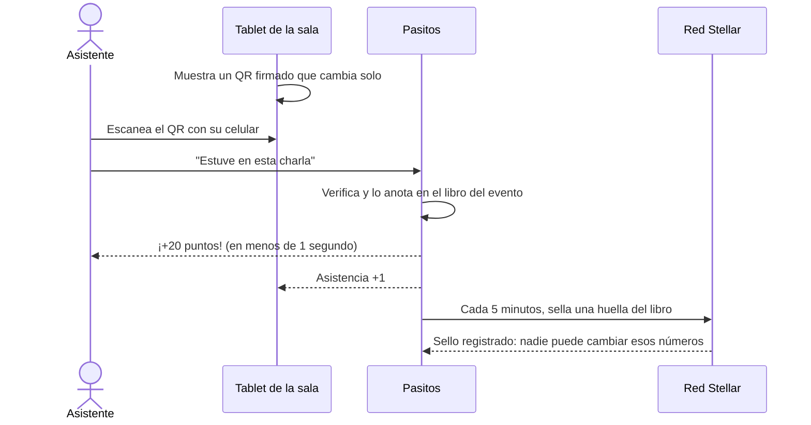
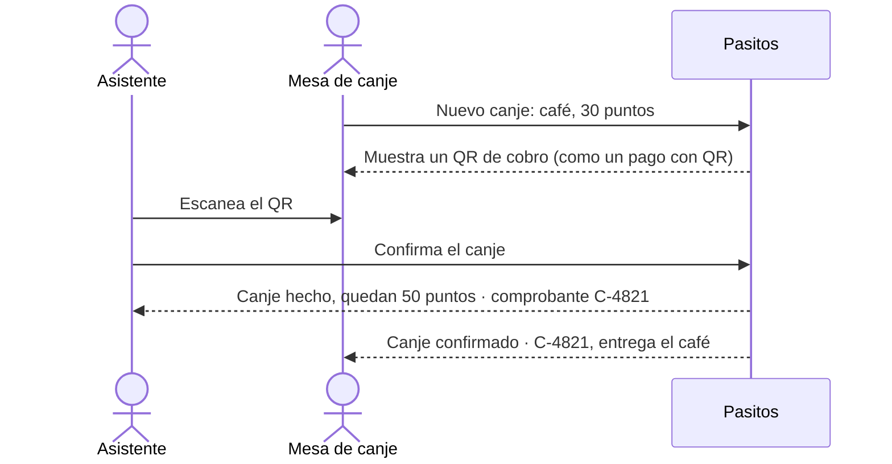
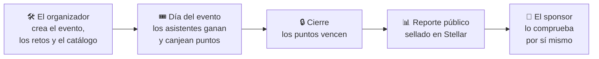

<p align="center">
  
</p>

<h1 align="center">Pasitos</h1>

<p align="center">
  <strong>Cada paso cuenta.</strong><br>
  Puntos por quedarse, reportes que se pueden comprobar.
</p>

<p align="center">
  
  
  
  
</p>

---

## ¿Qué es Pasitos?

Pasitos es una **web para el celular** que convierte la participación en un evento en **puntos**. Los asistentes ganan puntos por ir a las charlas, quedarse hasta el cierre o visitar stands, y los canjean por café, meriendas o merch.

Al terminar, el organizador recibe un **reporte que cualquiera puede comprobar**, para mostrarles a sus sponsors y financiadores qué logró su apoyo.

> **En una frase:** a los asistentes les damos un motivo para quedarse y a los sponsors, pruebas de lo que lograron.

---

## El problema

Quien ha organizado un evento lo conoce bien:

| | Lo que pasa hoy |
|---|---|
| 🚪 **La gente se va temprano** | Después del almuerzo las salas se vacían y las charlas del cierre quedan con pocas personas. |
| 🎁 **El merch se reparte mal** | Se lo llevan los primeros que llegan a la mesa, no los que más participaron. |
| 📸 **El sponsor solo recibe fotos** | El organizador no puede demostrar qué logró el aporte del sponsor. Manda fotos y un informe que hay que creerle. |

Y del lado de quien pone el dinero (una empresa, una fundación, una universidad, un ecosistema como Stellar), la cuenta es simple: **aporta, pero no sabe qué consiguió**, y muchas veces tiene que reportarlo a su directorio o a sus donantes.

> **Quien financia un evento no puede comprobar qué logró su aporte, y quien lo organiza no tiene cómo demostrarlo, aunque haya hecho un buen trabajo.**

---

## Cómo lo resuelve Pasitos

<table>
<tr>
<td width="25%" align="center"><h3>1 · Entra</h3>El asistente abre el link de su invitación o escanea el QR del evento. <b>No instala nada.</b></td>
<td width="25%" align="center"><h3>2 · Participa</h3>Cumple <b>retos</b>: ir a una charla, visitar un stand, quedarse al cierre, responder la encuesta.</td>
<td width="25%" align="center"><h3>3 · Canjea</h3>Cambia sus puntos por café, meriendas o merch en la <b>mesa de canje</b> del evento.</td>
<td width="25%" align="center"><h3>4 · Comprueba</h3>El organizador comparte un <b>reporte público</b> que el sponsor puede verificar por sí mismo.</td>
</tr>
</table>

Hay tres reglas que no cambian nunca:

- ✅ **Los puntos solo valen dentro del evento.** No se pueden transferir a otras personas ni sacar del evento.
- ✅ **Los puntos vencen al cierre y nunca se convierten en dinero.** Así nadie tiene motivos para hacer trampa.
- ✅ **No hay datos personales en la blockchain.** Ahí solo queda una huella de los números.

---

## ¿Quiénes lo usan?

| | Persona | Qué usa | Qué gana |
|---|---|---|---|
| 🙋 | **Asistente** | Su celular | Un motivo para participar y merch que se gana participando, no llegando primero |
| 🧑‍💼 | **Organizador** | Un panel en la computadora | Más gente hasta el cierre, asistencia en vivo y un reporte listo para los sponsors |
| 🏢 | **Sponsor o financiador** | Un reporte web | Datos que puede comprobar él mismo, no solo fotos |
| 🏪 | **Mesa de canje o stand** | Un celular o una tablet | Cobrar en puntos en segundos y saber cuánta gente pasó |

---

## Los flujos principales

### Ganar puntos con un QR

Cada sala o stand muestra en una tablet un **código QR que cambia cada pocos segundos**, o que sirve una sola vez. Por eso no sirve sacarle una foto y mandarla por WhatsApp.



Algunos retos no necesitan QR: por ejemplo, la encuesta se responde dentro de la app.

### Canjear puntos



### El evento de punta a punta



---

## ¿Por qué blockchain y por qué Stellar?

No usamos blockchain por moda: es lo que hace que el reporte sea creíble. Pasitos lleva un **libro de movimientos** y cada 5 minutos **sella en Stellar una huella** de lo nuevo, como un notario que pone su sello en cada página.

| | |
|---|---|
| 🔍 **Nadie puede alterar los números** | Si alguien cambiara un movimiento después, su huella dejaría de coincidir con la sellada en Stellar. El sponsor lo comprueba con un botón, sin confiar en nosotros ni en el organizador. |
| 🔒 **La red hace cumplir los topes** | El contrato rechaza cualquier sello que entregue más premios de los previstos para un reto. |
| ⚡ **Rápido y casi gratis** | El asistente recibe sus puntos al instante, y sellar un evento completo cuesta unos centavos, sea de 50 o de 5 000 personas. |
| 🌱 **Onboarding a Stellar, cuando se pide** | Con el plan Programa, un ecosistema puede sumar un módulo para que los asistentes creen su wallet y hagan sus primeras transacciones (después de la v1). |

¿Nunca usaste blockchain? Lee [Blockchain explicado fácil](docs/01-producto/04-blockchain-explicado-facil.md).

---

## Modelo de negocio

**Gratis para las comunidades → pagan los financiadores que necesitan reportar → las ferias pagan por uso.**

| Plan | Para quién | Qué incluye |
|---|---|---|
| **Comunidad** | Meetups, GDG y comunidades aprobadas | **Gratis.** App, retos, puntos, canje y reporte simple verificable. Estadísticas avanzadas opcionales |
| **Programa** | Ecosistemas, fundaciones y empresas que financian eventos | Todo lo anterior, más retos a medida, métricas de impacto, reporte con marca y soporte el día del evento |
| **Feria** | Ferias y eventos con venta | Pagos en dólares digitales en los stands y reembolso del saldo que sobra (después de la v1) |

---

## Estado del proyecto

| Etapa | Qué | Estado |
|---|---|---|
| Hackathon Stellar Elite Bolivia (octubre de 2026) | MVP en testnet, pitch y video de demo | ✅ Hecho |
| Próximos 3 meses | 3–5 eventos piloto con comunidades | 🔄 En curso |
| Próximos 6 meses | Primeros clientes pagos y postulación al Stellar Community Fund | ⏳ Pendiente |

El camino completo está en el [Roadmap](docs/01-producto/06-roadmap.md).

---

## Diseño

- **Mockups:** [nivel 1](docs/06-diseno/mockups/nivel-1.html) (las 11 pantallas esenciales) y [nivel 2](docs/06-diseno/mockups/nivel-2.html) (estados, errores, gestión del evento y sitio público), en tema oscuro y claro. Para verlos, descarga los archivos y ábrelos en el navegador.
- **Pensado para todos:** botones grandes, una sola acción principal por pantalla, textos claros y pocas animaciones. En los eventos también hay personas mayores.
- **Reglas de diseño:** [Design system](docs/06-diseno/02-design-system.md) · [Inventario de vistas](docs/06-diseno/05-inventario-de-vistas.md) · [Marca](docs/06-diseno/01-marca.md)

---

## Documentación

Toda la documentación está en español, en [docs/](docs/README.md). Por dónde empezar:

| Si eres… | Empieza por |
|---|---|
| **Nuevo en el equipo** | [Visión](docs/01-producto/01-vision.md) → [Cómo funciona](docs/01-producto/02-como-funciona.md) → [Flujos de la v1](docs/01-producto/07-flujos-v1.md) → [Decisiones](docs/decisiones.md) |
| **Desarrollador** | [Flujos de la v1](docs/01-producto/07-flujos-v1.md) → [Arquitectura](docs/04-tecnico/01-arquitectura.md) → [Libro y anclaje](docs/04-tecnico/07-libro-y-anclaje.md) → [Reglas de desarrollo](docs/09-desarrollo/README.md) |
| **Diseñador** | [UX y pantallas](docs/06-diseno/03-ux-y-pantallas.md) → [Design system](docs/06-diseno/02-design-system.md) |

¿Una palabra que no conoces? Está en el [Glosario](docs/glosario.md).

### Estructura del repositorio

```
apps/
├── app/                 Angular · app del asistente (/app)
├── sala/                Angular · pantalla de sala o stand (/sala)
├── mesa/                Angular · mesa de canje (/mesa)
├── admin/               Angular · panel del organizador y Puerta (/admin)
├── plataforma/          Angular · consola de plataforma (/plataforma)
├── sitio/               Angular SSR · sitio público (/)
├── api/                 NestJS + Fastify · API (/api/v1)
└── trabajador/          NestJS · colas y tareas programadas
libs/
├── dominio/             Errores, tipos y esquemas compartidos
├── firmas/              Firmas, QR y Merkle
├── db/                  Esquema, migraciones, RLS y semillas
├── ui/                  Design system (tokens y componentes px-…)
├── web-core/            Interceptores y errores de las apps web
└── testing/             Utilidades de test
contracts/evento/        Rust · contrato Soroban
e2e/                     Playwright · pruebas de punta a punta
infra/                   Compose de desarrollo y arranque de PostgreSQL
tools/                   Control de peso y servidor local
assets/brand/            Logo y recursos de marca
docs/
├── 01-producto/         Visión, cómo funciona, casos de uso, roadmap
├── 04-tecnico/          Arquitectura, libro y anclaje, rendimiento, stack, costos
├── 05-seguridad-legal/  Amenazas, pruebas, cumplimiento, términos y privacidad
├── 06-diseno/           Marca, design system, pantallas y mockups
├── 07-hackathon/        Material del hackathon (histórico)
├── 09-desarrollo/       Reglas de desarrollo: nomenclatura, backend, frontend, errores del API
├── decisiones.md        Registro de decisiones
└── glosario.md          Términos explicados
```

---

## Desarrollo

### Requisitos

| Herramienta | Versión |
|---|---|
| Node.js | **24.15 o superior** (ver `.node-version`). Angular 22 no compila el sitio con versiones anteriores |
| pnpm | 10 |
| Docker | Para PostgreSQL y los tests de la base |
| Rust | Estable, para el contrato |
| Stellar CLI | 25.2 o superior, solo para compilar el contrato a WASM |

### Primeros pasos

```bash
pnpm install
git config core.hooksPath .githooks   # revisa secretos y el formato de los commits
cp .env.example .env                  # valores de desarrollo
pnpm db:levantar                      # PostgreSQL 17 en el puerto 55432
pnpm db:migrar                        # crea las tablas y el aislamiento por organización
pnpm semilla minima                   # organización y evento de prueba
pnpm semilla produccion-demo          # organización demo con sus dos eventos
```

### Correr y probar

| Comando | Qué hace |
|---|---|
| `nx serve api` · `nx serve app` | Servidor de desarrollo de un proyecto |
| `pnpm build` y luego `pnpm local` | Todo con las rutas de producción en http://localhost:8080 (`/`, `/app/`, `/admin/`, `/api/v1/…`) |
| `pnpm test` | Tests unitarios y de integración (los de la base levantan PostgreSQL con Docker) |
| `pnpm e2e` | Pruebas de punta a punta con Playwright (Android, iPhone y escritorio) |
| `pnpm peso` | Peso comprimido de la carga inicial de cada app |
| `pnpm verificar` | Todo lo que revisa el CI, antes de abrir un PR |

Reglas para programar: [AGENTS.md](AGENTS.md) y [docs/09-desarrollo/](docs/09-desarrollo/README.md).

---

## Licencia

El código y la documentación de este repositorio se publican bajo la licencia [Apache 2.0](LICENSE).

---

<p align="center"><strong>Pasitos</strong> · Cada paso cuenta.</p>
