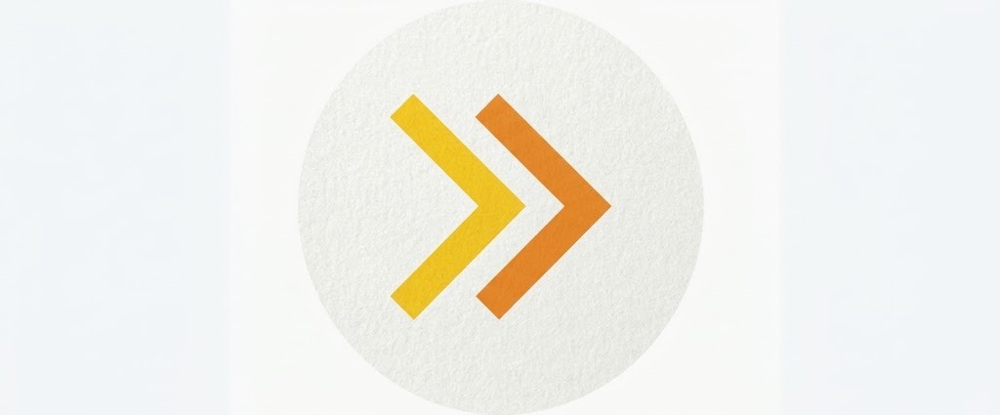
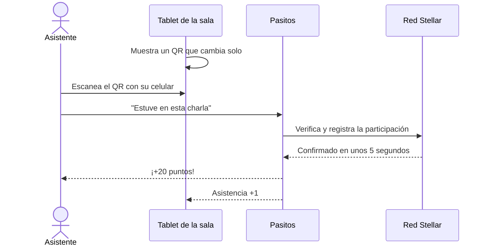
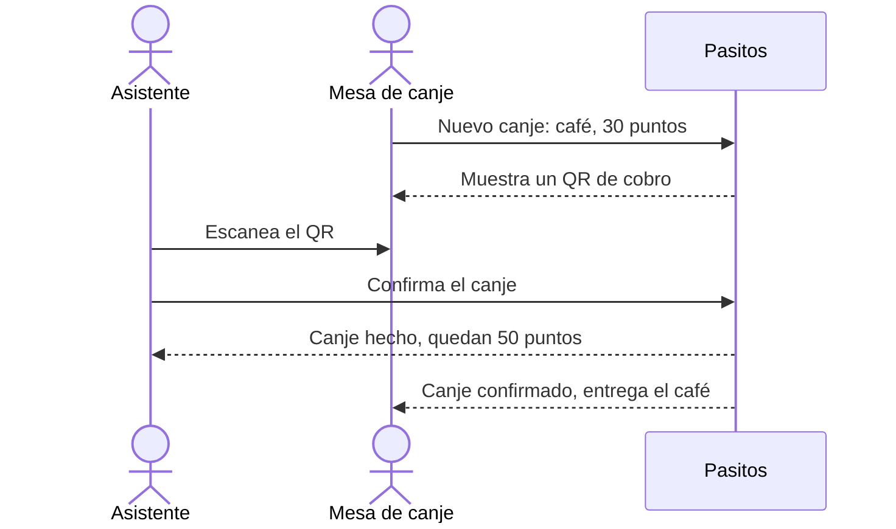
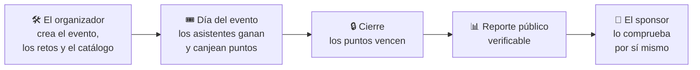

<p align="center">
  
</p>

<h1 align="center">Pasitos</h1>

<p align="center">
  <strong>Cada paso cuenta.</strong><br>
  Puntos por quedarse, reportes que se pueden comprobar.
</p>

<p align="center">
  
  
  
</p>

---

## ¿Qué es Pasitos?

Pasitos es una **web para el celular** que convierte la participación en un evento en **puntos**. Los asistentes ganan puntos por ir a las charlas, quedarse hasta el cierre o visitar stands, y los canjean por café, meriendas o merch.

Al terminar, el organizador recibe un **reporte que cualquiera puede comprobar**, para mostrarles a sus sponsors y financiadores qué logró su apoyo.

> **En una frase:** a los asistentes les damos un motivo para quedarse y a los sponsors, pruebas de lo que lograron.

---

## El problema

Quien ha organizado un evento lo conoce bien:

| | Lo que pasa hoy |
|---|---|
| 🚪 **La gente se va temprano** | Después del almuerzo las salas se vacían y las charlas del cierre quedan con pocas personas. |
| 🎁 **El merch se reparte mal** | Se lo llevan los primeros que llegan a la mesa, no los que más participaron. |
| 📸 **El sponsor solo recibe fotos** | El organizador no puede demostrar qué logró el aporte del sponsor. Manda fotos y un informe que hay que creerle. |

Y del lado de quien pone el dinero (una empresa, una fundación, una universidad, un ecosistema como Stellar), la cuenta es simple: **aporta, pero no sabe qué consiguió**, y muchas veces tiene que reportarlo a su directorio o a sus donantes.

> **Quien financia un evento no puede comprobar qué logró su aporte, y quien lo organiza no tiene cómo demostrarlo, aunque haya hecho un buen trabajo.**

---

## Cómo lo resuelve Pasitos

<table>
<tr>
<td width="25%" align="center"><h3>1 · Entra</h3>El asistente abre el link o escanea el QR de su entrada. <b>No instala nada ni crea una contraseña.</b></td>
<td width="25%" align="center"><h3>2 · Participa</h3>Cumple <b>retos</b>: ir a una charla, visitar un stand, quedarse al cierre, responder la encuesta.</td>
<td width="25%" align="center"><h3>3 · Canjea</h3>Cambia sus puntos por café, meriendas o merch en la <b>mesa de canje</b> del evento.</td>
<td width="25%" align="center"><h3>4 · Comprueba</h3>El organizador comparte un <b>reporte público</b> que el sponsor puede verificar por sí mismo.</td>
</tr>
</table>

Hay tres reglas que no cambian nunca:

- ✅ **Los puntos solo valen dentro del evento.** No se pueden transferir a otras personas ni sacar del evento.
- ✅ **Los puntos vencen al cierre y nunca se convierten en dinero.** Así nadie tiene motivos para hacer trampa.
- ✅ **No hay datos personales en la blockchain.** Ahí solo quedan números anónimos.

---

## ¿Quiénes lo usan?

| | Persona | Qué usa | Qué gana |
|---|---|---|---|
| 🙋 | **Asistente** | Su celular | Un motivo para participar y merch que se gana participando, no llegando primero |
| 🧑‍💼 | **Organizador** | Un panel en la computadora | Más gente hasta el cierre, asistencia en vivo y un reporte listo para los sponsors |
| 🏢 | **Sponsor o financiador** | Un reporte web | Datos que puede comprobar él mismo, no solo fotos |
| 🏪 | **Mesa de canje o stand** | Un celular o una tablet | Cobrar en puntos en segundos y saber cuánta gente pasó |

---

## Los flujos principales

### Ganar puntos con un QR

Cada sala o stand muestra en una tablet un **código QR que cambia cada pocos segundos**. Por eso no sirve sacarle una foto y mandarla por WhatsApp.



Algunos retos se **verifican solos**, sin QR. Por ejemplo, "Haz tu primera transacción en Stellar" se confirma automáticamente cuando la transacción aparece en la red.

### Canjear puntos



### El evento de punta a punta



---

## ¿Por qué blockchain y por qué Stellar?

No usamos blockchain por moda: es lo que hace que el reporte sea creíble.

| | |
|---|---|
| 🔍 **Nadie puede alterar los números** | Cada participación queda en un registro público. El sponsor no tiene que confiar en nosotros ni en el organizador. |
| 🔒 **La red hace cumplir las reglas** | Los puntos solo pueden estar en cuentas autorizadas por el evento. No es una regla de nuestra app que se pueda saltar: es una regla del propio activo. |
| ⚡ **Rápido y barato** | Cada movimiento se confirma en unos 5 segundos y cuesta una fracción de centavo. Pasitos paga esas comisiones, así que el asistente no paga nada. |
| 🌱 **Onboarding real** | Cada asistente sale con una wallet y sus primeras transacciones en Stellar, sin darse cuenta de la complejidad. |

¿Nunca usaste blockchain? Lee [Blockchain explicado fácil](docs/01-producto/04-blockchain-explicado-facil.md).

---

## Modelo de negocio

**Gratis para las comunidades → pagan los financiadores que necesitan reportar → las ferias pagan por uso.**

| Plan | Para quién | Precio (a validar) | Qué incluye |
|---|---|---|---|
| **Comunidad** | Meetups, GDG y comunidades aprobadas | **Gratis** | App, retos, puntos, canje y reporte simple verificable. Estadísticas avanzadas opcionales por $25 por evento |
| **Programa** | Ecosistemas, fundaciones y empresas que financian eventos | **$300–1 500** por evento | Todo lo anterior, más retos on-chain a medida, métricas de onboarding, reporte de impacto y soporte el día del evento |
| **Feria** | Ferias y eventos con venta | **2–3 %** de las ventas | Pagos en dólares digitales en los stands y reembolso del saldo que sobra |

Más detalle en [Modelo de ingresos](docs/02-negocio/03-modelo-de-ingresos.md).

---

## Estado del proyecto

| Etapa | Qué | Estado |
|---|---|---|
| Hackathon Stellar Elite Bolivia (octubre de 2026) | MVP en testnet, pitch y video de demo | ✅ Hecho |
| Próximos 3 meses | 3–5 eventos piloto con comunidades | 🔄 En curso |
| Próximos 6 meses | Primeros clientes pagos y postulación al Stellar Community Fund | ⏳ Pendiente |

El camino completo está en el [Roadmap](docs/01-producto/06-roadmap.md).

---

## Diseño

- **Mockup inicial:** [docs/06-diseno/mockups/nivel-1.html](docs/06-diseno/mockups/nivel-1.html) muestra las 11 pantallas esenciales en tema oscuro y claro. Para verlo, descarga el archivo y ábrelo en el navegador.
- **Pensado para todos:** botones grandes, una sola acción principal por pantalla, textos claros y pocas animaciones. En los eventos también hay personas mayores.
- **Reglas de diseño:** [Design system](docs/06-diseno/02-design-system.md) · [Inventario de vistas](docs/06-diseno/05-inventario-de-vistas.md) · [Marca](docs/06-diseno/01-marca.md)

---

## Documentación

Toda la documentación está en español, en [docs/](docs/README.md). Por dónde empezar:

| Si eres… | Empieza por |
|---|---|
| **Nuevo en el equipo** | [Visión](docs/01-producto/01-vision.md) → [Cómo funciona](docs/01-producto/02-como-funciona.md) → [Decisiones](docs/decisiones.md) |
| **Desarrollador** | [Arquitectura](docs/04-tecnico/01-arquitectura.md) → [Contrato `challenges`](docs/04-tecnico/02-contrato-challenges.md) → [Setup en testnet](docs/04-tecnico/06-setup-testnet.md) |
| **Diseñador** | [UX y pantallas](docs/06-diseno/03-ux-y-pantallas.md) → [Design system](docs/06-diseno/02-design-system.md) |
| **Negocio y ventas** | [Clientes y segmentos](docs/02-negocio/02-clientes-y-segmentos.md) → [Modelo de ingresos](docs/02-negocio/03-modelo-de-ingresos.md) |

¿Una palabra que no conoces? Está en el [Glosario](docs/glosario.md).

### Estructura del repositorio

```
assets/brand/            Logo y recursos de marca
docs/
├── 01-producto/         Visión, cómo funciona, casos de uso, roadmap
├── 02-negocio/          Mercado, clientes, modelo de ingresos, economía
├── 03-validacion/       Entrevistas, hipótesis y resultados
├── 04-tecnico/          Arquitectura, contrato, datos, costos, setup
├── 05-seguridad-legal/  Amenazas, pruebas y cumplimiento
├── 06-diseno/           Marca, design system, pantallas y mockups
├── 07-hackathon/        Material del hackathon (histórico)
├── decisiones.md        Registro de decisiones
└── glosario.md          Términos explicados
```

---

<p align="center"><strong>Pasitos</strong> · Cada paso cuenta.</p>
