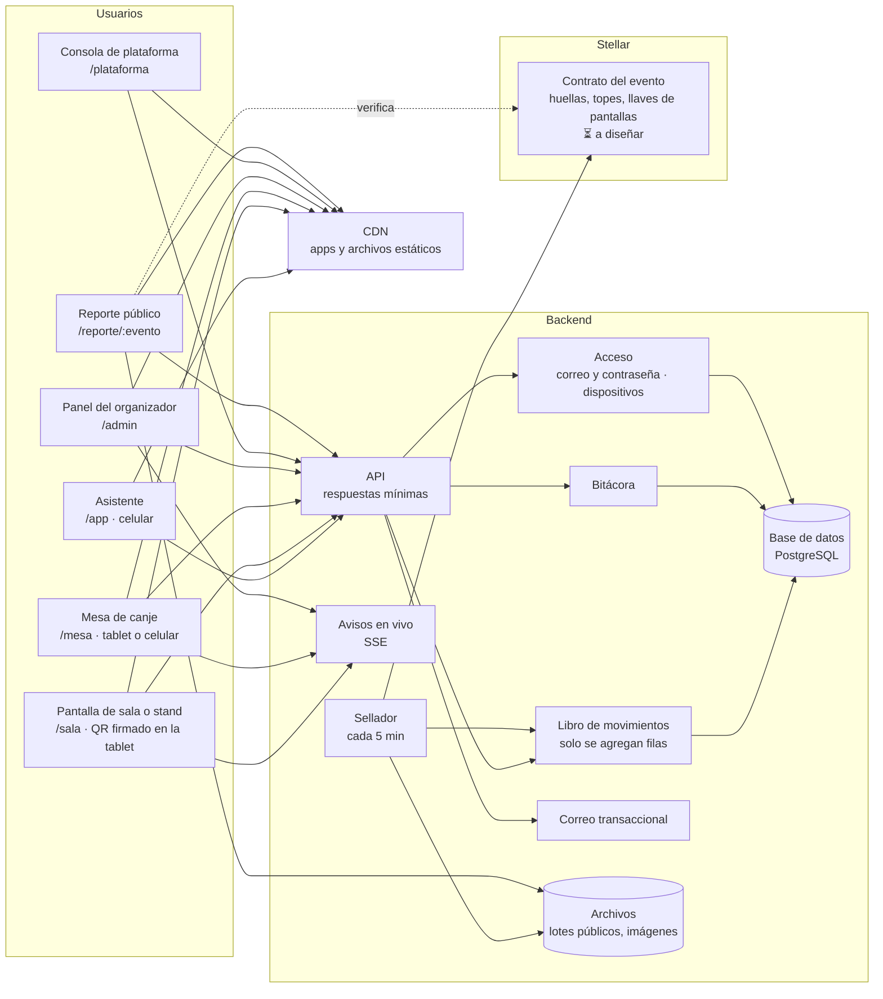

# Arquitectura

> **Estado:** ✅ vigente para la v1 · **Última revisión:** 2026-11-06
> Reemplaza la arquitectura del MVP del hackathon (una transacción por acción, wallets custodiadas). Lo que cambió y por qué está en D22 y D24 ([decisiones](../decisiones.md)).
> Relacionados: [Flujos de la v1](../01-producto/07-flujos-v1.md) · [Libro y anclaje](07-libro-y-anclaje.md) · [Rendimiento](08-rendimiento.md) · [Datos on-chain](03-datos-on-chain.md) · [Herramientas](05-herramientas.md)

## 1. Vista general

## 2. Principios

1. **Durante el evento, el servidor decide; Stellar sella.** Cada reclamo y cada canje se valida y se registra en el libro al instante. Cada 5 minutos se ancla una huella en Stellar, y el contrato rechaza el lote si se pasó un tope.
2. **On-chain va solo lo que alguien necesita verificar sin confiar en nosotros:** los topes, las llaves públicas de las pantallas, las huellas y el cierre. Ningún dato personal ([Datos on-chain](03-datos-on-chain.md)).
3. **Respuestas livianas y rápidas:** presupuesto de rendimiento en [Rendimiento](08-rendimiento.md).
4. **Todo cambio administrativo deja rastro** en la bitácora. Todo movimiento de puntos queda en el libro.

## 3. Componentes

| Componente | Tecnología ([Stack](09-stack-tecnologico.md), D38) | Responsabilidad |
|---|---|---|
| Frontend | Angular (zoneless, signals) + Tailwind. Una aplicación por perfil, con límites de peso. Plan B para `/app` si no entra en el presupuesto | Apps del asistente, de la pantalla, de la mesa, panel, consola y reporte |
| API | NestJS sobre Fastify (Node.js LTS, TypeScript) | Acceso, eventos, inscripciones, check-in, reclamos, canjes, ajustes, reportes |
| Avisos en vivo | Server-Sent Events | Contador de pantallas, confirmaciones de la mesa, panel en vivo |
| Libro de movimientos | Tabla de PostgreSQL donde solo se agregan filas, más el saldo actual por asistente | Puntos ([Libro y anclaje](07-libro-y-anclaje.md)) |
| Bitácora | Tabla de PostgreSQL donde solo se agregan filas | Acciones administrativas ([Flujos §4.4](../01-producto/07-flujos-v1.md#44-bitácora)) |
| Sellador | Trabajador con pg-boss + `@stellar/stellar-sdk` | Calcular la huella de cada lote, anclarla y publicar el lote |
| Base de datos | PostgreSQL + Drizzle ORM | Todo lo off-chain. Las transacciones de la base garantizan que saldo, stock y movimiento cambien juntos |
| Archivos | Almacenamiento de objetos + CDN | Lotes públicos, logos, mapas, fotos del catálogo |
| Correo | Proveedor transaccional (SPF, DKIM, DMARC) | Códigos, invitaciones, confirmaciones, avisos |
| Llaves del servidor | En el VPS: cifradas con `sops` + `age`; KMS o HSM más adelante | La llave del operador que ancla nunca está en el repositorio ni en los logs, y su cuenta tiene poco XLM ([Stack §5](09-stack-tecnologico.md#llaves-en-un-vps-ajuste-a-d22)) |
| Contrato | Soroban (Rust) · ⏳ | Requisitos en [Libro y anclaje §8](07-libro-y-anclaje.md#8-qué-tendrá-que-hacer-el-contrato) |

## 4. Identidad y llaves

| Quién | Cómo se identifica | Llaves |
|---|---|---|
| Personas (asistentes, equipo, administradores) | Correo verificado y contraseña (Argon2id); segundo factor en la consola de plataforma (D25, D26). En cada evento, un código de asistente | El celular del asistente crea una llave (WebCrypto P-256, no exportable) para firmar sus reclamos |
| Pantallas de sala | Dispositivo conectado con QR o enlace de un solo uso (D18) | Llave propia, creada en la tablet. La pública se registra en Stellar antes del evento |
| Mesas de canje | Dispositivo conectado con QR o enlace de un solo uso (D18) | Credencial del dispositivo, revocable desde el panel |
| Servidor | — | Llave del operador del contrato, cifrada en el VPS. Se puede cambiar (rotar). La llave de administración del contrato vive fuera del servidor |

**En la v1 no hay wallets de Stellar para los asistentes.** Si un plan Programa quiere onboarding a Stellar, será un módulo opcional ([roadmap](../01-producto/06-roadmap.md)).

## 5. API por área

Rutas orientativas. El detalle se escribe junto con el plan de implementación.

| Área | Rutas |
|---|---|
| Acceso | `POST /auth/registro` · `POST /auth/verificar-correo` · `POST /auth/entrar` · `POST /auth/recuperar` · `POST /auth/restablecer` · `GET/DELETE /auth/sesiones` |
| Plataforma | `/plataforma/solicitudes` · `/organizaciones` · `/planes` · `/suscripciones` · `/pagos` · `/dashboard` · `/reportes` |
| Eventos | `/eventos` (crear, configurar, publicar, pausar, cerrar) · `/eventos/:id/agenda` · `/mapa` · `/lugares` · `/sponsors` · `/retos` · `/productos` |
| Equipo | `/eventos/:id/equipo` (invitar, cambiar rol, quitar) |
| Dispositivos | `POST /eventos/:id/dispositivos/vinculo` (QR o enlace de un solo uso) · `POST /dispositivos/conectar` · `DELETE /dispositivos/:id` |
| Inscripciones | `/eventos/:id/invitados` (importar, enviar invitaciones) · `POST /eventos/:slug/registro` · `POST /inscripciones/:id/checkin` |
| Asistente | `GET /app/estado` (una sola llamada, con `ETag`) · `POST /reclamos` · `POST /encuestas/:id` |
| Pantallas | `POST /pantallas/:id/estado` (pausa, generar otro, mostrar QR) · SSE `/pantallas/:id/vivo` |
| Canje | `POST /mesa/cobros` · `POST /cobros/:id/confirmar` · `DELETE /mesa/cobros/:id` · SSE `/mesa/vivo` |
| Gestión | `POST /ajustes` · `POST /canjes/:id/anular` · `GET /bitacora` · SSE `/eventos/:id/vivo` |
| Público | `GET /reporte/:evento` · `GET /reporte/:evento/lotes/:n` · `GET /reporte/:evento/verificar` |

**Reglas de la API:**
- Todo `POST` que mueve puntos o stock lleva un **ID de envío** (clave de idempotencia).
- **No existe ninguna ruta para transferir puntos entre asistentes** (D3).
- Los permisos se revisan en el servidor en cada ruta, según el rol y el alcance de la persona en ese evento ([Flujos §2.4](../01-producto/07-flujos-v1.md#24-roles-y-permisos-d19)).

## 6. Vistas

| Vista | Ruta | Dispositivo |
|---|---|---|
| Sitio público y solicitud del plan Comunidad | `/` | Cualquiera |
| Asistente | `/app` | Celular |
| Pantalla de sala o stand | `/sala` | Tablet o monitor |
| Mesa de canje | `/mesa` | Tablet o celular |
| Panel del organizador | `/admin` | Computadora (el registrador, en celular) |
| Consola de plataforma | `/plataforma` | Computadora |
| Reporte público y verificación | `/reporte/:evento` | Cualquiera |

## 7. Más adelante

- **Modo sin conexión:** cola de reclamos en el celular y sincronización a través de la mesa (D23, fuera de la v1).
- **Feria:** saldo en dólares con USDC on-chain. Ahí sí conviene una transacción por pago, porque es dinero real y la comisión del plan la cubre.
- **Onboarding a Stellar** (plan Programa): wallets opcionales con passkey, retos on-chain e insignias.
- **Eventos grandes:** réplicas de lectura, colas para el sellador, más regiones.
