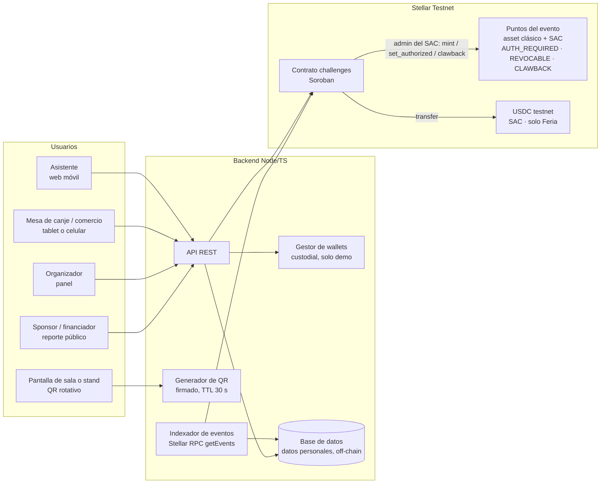

# Arquitectura

> **Estado:** vigente (MVP en testnet) · **Última revisión:** 2026-11-03
> Relacionados: [Contrato `challenges`](02-contrato-challenges.md) · [Datos on-chain](03-datos-on-chain.md) · [Herramientas](05-herramientas.md) · [Setup de testnet](06-setup-testnet.md)

## 1. Vista general

**Principio:** on-chain va solo lo que alguien necesita verificar sin confiar en nosotros (puntos, reglas, participaciones, cierre). Todo lo demás, incluidos los datos personales, queda off-chain. Detalle en [Datos on-chain](03-datos-on-chain.md).

## 2. Componentes

| Componente | Tecnología | Responsabilidad |
|---|---|---|
| Frontend | React + Vite (Scaffold Stellar) + Tailwind | Una sola app web con rutas por perfil |
| Backend | Node / TypeScript + `@stellar/stellar-sdk` | API, QR rotativo, wallets demo, verificación automática de retos, indexador |
| Contrato `challenges` | Soroban (Rust) | Reglas del evento: retos, límites, canjes, cierre |
| Puntos | Asset clásico + Stellar Asset Contract (SAC) | Saldo de puntos con circuito cerrado |
| USDC | SAC de USDC | Saldo en dólares (solo en la variante Feria) |
| Base de datos | A definir | Datos personales, catálogo, eventos indexados, tarifas y facturación |

## 3. Wallets de los asistentes

| | MVP | Producción |
|---|---|---|
| Tipo | Cuenta clásica creada por el backend para cada asistente (**custodial, solo demo**) | Smart wallet con passkey (`smart-account-kit`); el asistente firma con huella o Face ID |
| Comisiones | Las paga la cuenta del organizador (fee bump) | OpenZeppelin Relayer (fee sponsorship) |
| Fondos iniciales | Friendbot en testnet | Reservas patrocinadas por el organizador |
| Trustlines | El backend crea las trustlines de puntos (y de USDC en ferias) | Las smart wallets no necesitan trustlines para los SAC |

> Hay que decirlo con claridad: **"en el MVP el backend custodia las llaves; en producción cada asistente firma con passkey"**.

## 4. Backend: endpoints

| Endpoint | Descripción |
|---|---|
| `POST /attendees` | Recibe el código de la entrada, crea la wallet y llama `register_attendee` |
| `GET /stands/:challengeId/qr` | Devuelve el QR firmado vigente (rota cada 30 s) |
| `POST /claims` | Valida el QR y ejecuta `claim` |
| `POST /redeem` | Firma `redeem` en nombre del asistente (demo custodial) |
| `POST /pay` | Firma `pay` (solo Feria) |
| `POST /refund` | Firma `refund` y registra la devolución (solo Feria) |
| `GET /balances/:attendee` | Saldo de puntos (y de USDC en ferias) |
| `GET /stats/event` | Asistentes activos por franja horaria, participaciones por reto, canjes |
| `GET /stats/sponsor/:sponsor` | Participaciones en los retos de un sponsor |
| `GET /reporte/:evento` | Datos del reporte público verificable, con enlaces a Stellar Expert |

**No existe ningún endpoint para transferir puntos entre asistentes** (decisión D3).

**Indexador:** un proceso que llama a `getEvents` de Stellar RPC cada pocos segundos, filtrando por el ID del contrato `challenges`, y guarda los eventos en la base de datos para el panel y el reporte.

**Verificación automática:** para retos como "haz tu primera transacción en Stellar", el backend observa la red y, cuando detecta la transacción de la wallet del asistente, ejecuta `claim` como `verifier`. No hace falta QR.

## 5. Frontend: vistas

| Vista | Ruta | Dispositivo | Contenido |
|---|---|---|---|
| Asistente | `/app` | Móvil | Saldo de puntos, botón "Escanear", retos, canje, historial |
| Sala / stand | `/stand/:id` | Tablet o monitor | QR rotativo grande y contador de asistencia en vivo |
| Mesa de canje | `/merchant` | Tablet o móvil | Generar QR de cobro y ver los canjes recibidos |
| Panel | `/admin` | Desktop | Resumen, retos, reporte para compartir, estadísticas avanzadas (bloqueadas), cierre del evento |
| Reporte público | `/reporte/:evento` | Web responsiva | Reporte simple verificable |

El detalle de pantallas y estados está en [UX y pantallas](../06-diseno/03-ux-y-pantallas.md).

## 6. Escalabilidad (producción)

- **Picos** (la fila del café a las 10:30): relayer con *channel accounts* para enviar transacciones en paralelo y fee bump del organizador.
- **Menos transacciones:** `claim_batch(Vec<(Address, u32)>)` para enviar los retos completados en lotes cada 5–10 s.
- **Wifi malo en el lugar:** vouchers firmados en el teléfono que se liquidan on-chain al recuperar la conexión.
- **Varios eventos:** un contrato *factory* que despliega un `challenges` y un asset por evento, más un panel para organizadores.
- **Reputación entre eventos:** un badge intransferible de "asistente frecuente"; los puntos siguen siendo locales.
