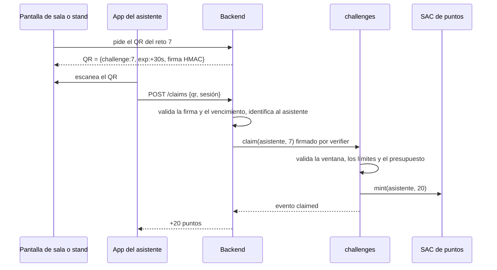

# Contrato `challenges` y token de puntos

> **Estado:** vigente (MVP en testnet) · **Última revisión:** 2026-11-03

## 1. Decisión: token de puntos

### Opción A (la del MVP): asset clásico + Stellar Asset Contract (SAC)

- Se emite el asset del evento (ej. `FORO26`) desde una cuenta emisora con los flags `AUTH_REQUIRED`, `AUTH_REVOCABLE` y `AUTH_CLAWBACK_ENABLED`.
- Se despliega su SAC y se **transfiere el rol de admin del SAC al contrato `challenges`**. Desde ese momento, solo el contrato puede emitir (`mint`), autorizar (`set_authorized`) y recuperar (`clawback`).
- **Circuito cerrado nativo:** una wallet no autorizada no puede recibir puntos. La transferencia falla en la red, no en la app.
- Menos código propio: no escribimos un contrato de token.

### Opción B (producción): token SEP-41 propio con OpenZeppelin

- Contrato con `stellar-tokens` (fungible) de OpenZeppelin, con la extensión de allowlist y un rol de minter para `challenges`. Verificar el nombre exacto de la extensión en la versión de la librería que se use.
- **Se necesita en producción** para que el contrato solo acepte transferencias hacia comercios registrados (ver la sección 4, D3).

## 2. Almacenamiento

| Clave | Tipo | Storage | Descripción |
|---|---|---|---|
| `Admin` | `Address` | instance | Organizador |
| `Verifier` | `Address` | instance | Cuenta del backend que valida los QR y ejecuta `claim` |
| `Points` | `Address` | instance | SAC de los puntos |
| `Usdc` | `Address` | instance | SAC de USDC (solo Feria) |
| `Treasury` | `Address` | instance | Cuenta del organizador que recibe los reembolsos |
| `CashbackBps` | `u32` | instance | Cashback en puntos por pago con USDC (500 = 5 %) |
| `Closed` | `bool` | instance | Evento cerrado |
| `Paused` | `bool` | instance | Pausa de emergencia |
| `Challenge(u32)` | `Challenge` | persistent | Definición del reto |
| `Claims(Address, u32)` | `u32` | persistent | Veces que un asistente completó un reto |
| `Merchant(Address)` | `bool` | persistent | Comercio o mesa de canje habilitada |
| `Attendee(Address)` | `bool` | persistent | Asistente registrado |

```rust
#[contracttype]
pub struct Challenge {
    pub sponsor: Address,
    pub reward: i128,        // puntos por completarlo
    pub max_per_user: u32,   // normalmente 1
    pub max_total: u32,      // presupuesto de premios: máximo de participaciones del reto
    pub claimed_total: u32,
    pub start: u64,          // timestamp del ledger
    pub end: u64,
    pub active: bool,
}
```

## 3. Funciones

| Función | Quién autoriza | Qué hace | Evento emitido |
|---|---|---|---|
| `init(admin, verifier, points, usdc, treasury, cashback_bps)` | — (una vez) | Configura el contrato | — |
| `register_attendee(attendee)` | `verifier` | Marca al asistente y llama `points.set_authorized(attendee, true)` | `attendee_registered` |
| `add_merchant(merchant)` | `admin` | Habilita el comercio y lo autoriza en el SAC | `merchant_added` |
| `create_challenge(id, challenge)` | `admin` | Crea un reto | `challenge_created` |
| `set_challenge_active(id, active)` | `admin` | Activa o desactiva un reto | — |
| `claim(attendee, challenge_id)` | `verifier` | Valida el estado (no cerrado, no pausado, reto activo, ventana horaria, límite por usuario, límite total) y llama `points.mint(attendee, reward)` | `claimed(sponsor, challenge_id, attendee, reward)` |
| `redeem(attendee, merchant, amount, item_id)` | `attendee` | Transfiere puntos del asistente al comercio | `redeemed(merchant, attendee, amount, item_id)` |
| `pay(attendee, merchant, usdc_amount)` | `attendee` | *(Feria)* Transfiere USDC al comercio y emite el cashback en puntos | `paid(merchant, attendee, usdc_amount, cashback)` |
| `refund(attendee)` | `attendee` | *(Feria)* Devuelve todo el USDC del asistente a `treasury`; el reembolso en moneda local ocurre off-chain | `refund_requested(attendee, amount)` |
| `close_event()` | `admin` | `Closed = true`: no se permiten más claims, canjes ni pagos | `event_closed` |
| `expire(holders: Vec<Address>)` | `admin` | `clawback` del saldo de puntos de cada holder (en lotes) | `expired(count)` |
| `pause()` / `unpause()` | `admin` | Pausa de emergencia | `paused` / `unpaused` |
| `get_challenge(id)`, `claims_of(attendee, id)`, `is_closed()` | — | Lectura | — |

## 4. Errores

```rust
#[contracterror]
#[derive(Copy, Clone, Debug, Eq, PartialEq)]
#[repr(u32)]
pub enum Error {
    AlreadyInitialized = 1,
    NotInitialized     = 2,
    EventClosed        = 3,
    Paused             = 4,
    ChallengeNotFound  = 5,
    ChallengeInactive  = 6,
    OutOfWindow        = 7,
    UserLimitReached   = 8,
    BudgetExhausted    = 9,
    NotAttendee        = 10,
    NotMerchant        = 11,
    InvalidAmount      = 12,
}
```

Los mensajes que ve el usuario para cada error están en [UX y pantallas §3](../06-diseno/03-ux-y-pantallas.md#3-estados-tiempos-y-mensajes).

## 5. Decisiones de producto que afectan al contrato

Ver [decisiones.md](../decisiones.md).

- **Sin pagos mixtos (D6):** `redeem` cobra solo en puntos y `pay` solo en USDC. No existe una función que combine ambos.
- **Sin transferencias entre asistentes (D3):** el contrato no ofrece ninguna función de transferencia entre asistentes, y el backend no expone el `transfer` del SAC. **Limitación conocida de la opción A:** el SAC sí permitiría un `transfer` entre dos asistentes autorizados si alguien lo firmara con la llave del asistente. En el MVP no pasa porque el backend custodia las llaves. Con passkeys (producción) hay que pasar a la opción B y aceptar transferencias solo hacia comercios registrados.
- **`max_total` es el presupuesto de premios** que el organizador asigna a cada reto. El contrato garantiza que nunca se entreguen más premios que los previstos.

## 6. Reglas que NO se pueden saltar (invariantes)

1. Los puntos solo se emiten desde `claim` y `pay`, nunca de otra forma.
2. `claimed_total ≤ max_total` siempre.
3. `Claims(attendee, id) ≤ max_per_user` siempre.
4. Con `Closed = true`, ninguna función que mueve valor funciona, salvo `refund` y `expire`.
5. `refund` debe seguir funcionando con el evento cerrado y con el contrato en pausa: **el saldo en dólares siempre es recuperable**.
6. Todo `amount` es mayor que 0.

## 7. Flujos

### 7.1 Completar un reto con QR



El QR rotativo evita que alguien mande una foto del QR por WhatsApp a gente que no está en la sala. El límite por usuario en el contrato evita reclamar dos veces aunque el backend falle.

### 7.2 Reto verificado automáticamente

1. El asistente hace la acción (ej. su primera transacción en Stellar).
2. El backend la detecta on-chain asociada a la wallet del asistente.
3. El backend ejecuta `claim(asistente, id)` como `verifier`. El contrato aplica las mismas reglas.

### 7.3 Canje en la mesa

1. La mesa elige el producto y muestra un QR con `{merchant, item_id, amount, currency}` (`PTS` → `redeem`; `USDC` → `pay`, solo Feria).
2. El asistente lo escanea y confirma.
3. La app firma `redeem(asistente, comercio, amount, item_id)`.
4. La mesa ve el evento `redeemed` en su pantalla y entrega el producto.

### 7.4 Intento de sacar puntos del evento

El asistente intenta enviar puntos a una wallet externa. La operación falla porque la wallet de destino no está autorizada para el asset.

- Con una invocación Soroban al SAC (`transfer`), la falla ocurre en la **simulación** y la transacción no llega a la red. Sirve para los tests, pero no deja rastro en Stellar Expert.
- Para mostrarlo en una demo se usa una **operación clásica `payment`** hacia una wallet con trustline no autorizada, enviada sin chequeo previo. La red la registra como **fallida** (`op_not_authorized`) y se puede ver en Stellar Expert. Si la wallet no tiene trustline, el error es `op_no_trust`.

### 7.5 Saldo en dólares (solo Feria)

- **Carga:** en el MVP es simulada (botón "Cargar 10 USD"; el backend transfiere USDC de testnet desde la tesorería). En producción: pago con QR bancario o tarjeta, y un anchor (SEP-24) o un proveedor autorizado acredita el USDC.
- **Pago:** `pay` → USDC al comercio + 5 % en puntos.
- **Reembolso:** `refund` → USDC a la tesorería, y el backend registra la devolución en moneda local.
