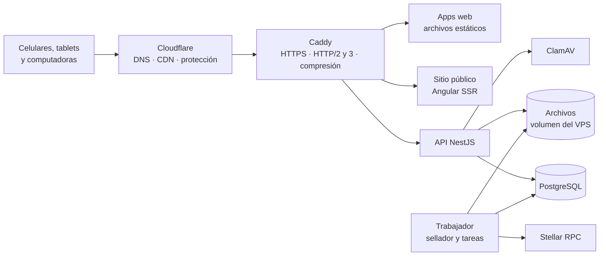

# Stack tecnológico

> **Estado:** ✅ vigente (D38) · **Última revisión:** 2026-11-13
> Con qué se construye Pasitos desde la versión piloto en adelante, y por qué. Se eligió pensando en todo el proyecto, no solo en el piloto, y en lo que el equipo ya domina: **Angular, NestJS y TypeScript**.
> Relacionados: [Arquitectura](01-arquitectura.md) · [Rendimiento](08-rendimiento.md) · [Libro y anclaje](07-libro-y-anclaje.md) · [Herramientas](05-herramientas.md)

## 1. Resumen

| Capa | Elección | En una línea |
|---|---|---|
| Lenguaje | **TypeScript** en todo, salvo el contrato | Un solo lenguaje entre frontend, backend y tipos compartidos |
| Frontend (las 5 apps) | **Angular** (versión estable más reciente, *zoneless* y con *signals*) | El equipo ya lo domina, y trae de fábrica lo que el proyecto necesita |
| Sitio público | **Angular SSR** (renderizado en el servidor y prerender) | HTML rápido, vista previa en WhatsApp y el mismo framework |
| Estilos | **Tailwind CSS v4** + tokens del design system como variables CSS | Tema claro hoy y oscuro después, sin rehacer componentes |
| Componentes | Propios + **Angular CDK** | Sin librerías pesadas en la app del asistente |
| Backend | **NestJS** sobre **Fastify**, en **Node.js 24 LTS** | El equipo lo domina; ordena bien un dominio grande |
| Base de datos | **PostgreSQL** (17 o 18) | Transacciones y bloqueos fuertes para el libro, el saldo y el stock |
| Acceso a datos | **Drizzle ORM** + migraciones con drizzle-kit | SQL explícito, transacciones y bloqueos sin pelear con el ORM |
| Validación y tipos compartidos | **Zod**, en una librería compartida | El mismo esquema valida en el panel y en el API |
| Trabajos programados | **pg-boss** (cola sobre PostgreSQL) | Sellador, correos por tandas y borrados, sin sumar Redis |
| Avisos en vivo | **SSE** + `LISTEN/NOTIFY` de PostgreSQL | Simple, liviano y suficiente para un servidor |
| Contrato | **Rust + Soroban SDK**, desplegado con **Stellar CLI** | Lo único que no es TypeScript |
| Stellar desde el servidor | **@stellar/stellar-sdk**, solo en el backend | El navegador nunca carga el SDK |
| Monorepo | **Nx** + **pnpm** | Angular y NestJS en un solo repositorio, con límites entre apps |
| Pruebas | **Vitest**, **Playwright**, **k6**, `cargo test` | Unitarias, de punta a punta, de carga y del contrato |
| Infraestructura | **VPS propio con Docker Compose**, **Caddy** y **Cloudflare** adelante | Lo que eligieron, con poco mantenimiento |

## 2. Qué le pide el proyecto al stack

| # | Requisito | De dónde sale |
|---|---|---|
| R1 | La app del asistente pesa **≤ 250 KB** en la primera carga y abre en **< 3 s en 4G** | [Rendimiento](08-rendimiento.md) |
| R2 | Service worker para cachear la información del evento | Rendimiento, Flujos §5.2 |
| R3 | Firmas con **WebCrypto** (P-256, llave no exportable) y lector de QR con respaldo | [Libro y anclaje](07-libro-y-anclaje.md), Acceso del asistente |
| R4 | Avisos en vivo: contador de la pantalla, mesa, panel y alertas | Flujos §6 y §7 |
| R5 | **Transacciones fuertes:** saldo, stock, topes y movimiento cambian juntos o no cambian | Libro y anclaje |
| R6 | Trabajos programados confiables: sellar cada 5 min **en orden**, correos por tandas, borrado a los 30 días | Plan, fases 1 y 4 |
| R7 | Paneles grandes: formularios, tablas, filtros, roles, bitácora | Panel del organizador y consola |
| R8 | Sitio público con buena vista previa al compartirse (SEO y Open Graph) y muy liviano | D37 |
| R9 | Contrato Soroban con tests y despliegue repetible | HU-102 |
| R10 | Tema claro hoy y oscuro después (D36) | Design system |
| R11 | Crecer después: Feria con USDC, cuentas de asistente, portales de sponsors, app instalable | Roadmap |
| R12 | Un equipo chico que mantiene todo, sobre un VPS propio | Esta decisión |

## 3. Frontend: por qué Angular

### 3.1 Comparación

| Criterio | **Angular** | React + Vite | SvelteKit | Next.js (React) |
|---|---|---|---|---|
| El equipo ya lo domina | ✅ **Sí** | ❌ Hay que aprender | ❌ Hay que aprender | ❌ Hay que aprender |
| Peso de la app del asistente (R1) | 🟡 Alcanza **con disciplina**: zoneless, sin librerías de UI, `@defer` | 🟢 Bueno (mejor aún con Preact) | 🟢 El más liviano | 🟡 Similar a React, más el runtime de Next |
| Paneles grandes (R7) | 🟢 Su punto fuerte: formularios tipados, CDK, inyección de dependencias | 🟡 Hay que elegir y combinar librerías | 🟡 Ecosistema más chico | 🟡 Igual que React |
| Service worker (R2) | 🟢 Incluido (`@angular/service-worker`) | 🟡 Plugin aparte | 🟡 A mano | 🟡 Plugin aparte |
| Límites de peso en el build (R1) | 🟢 Incluidos (*budgets* en `angular.json`) | 🟡 Plugin aparte | 🟡 Plugin aparte | 🟡 Plugin aparte |
| SSR y prerender (R8) | 🟢 Incluido, con hidratación incremental | 🟡 Requiere otro framework | 🟢 Incluido | 🟢 Su punto fuerte |
| Estabilidad a largo plazo (R11) | 🟢 Versiones cada 6 meses con migraciones automáticas | 🟢 Muy estable | 🟡 Cambios grandes entre versiones | 🟡 Cambia seguido de modelo |

### 3.2 Recomendación

**Angular para las cinco apps y para el sitio público.**
- Es lo que el equipo domina. Aprender otro framework a la vez que el dominio, Soroban y el piloto es el riesgo más grande del plan.
- Trae de fábrica justo lo que el proyecto pide: service worker, límites de peso que hacen fallar el build, SSR, formularios tipados y el CDK para paneles.
- El único punto débil es el peso de la app del asistente. Se controla así:
  - **Cada app es una aplicación Angular separada** (`app`, `sala`, `mesa`, `admin`, `plataforma`, `sitio`). La app del asistente nunca carga código del panel; Nx lo impide con reglas de límites entre módulos.
  - **Zoneless y signals**, sin Zone.js.
  - **Sin librerías de componentes** en `/app`, `/sala` y `/mesa`: componentes propios con Tailwind. Angular CDK solo en los paneles.
  - **`@defer` y carga diferida** para la cámara, el lector de QR y las pantallas secundarias.
  - **Budgets estrictos** en `angular.json`: el build falla si `/app` pasa su límite (T-006).

**Verificación de peso al empezar (T-008, fase 0):** una app Angular mínima con router, service worker, WebCrypto y el lector de QR, medida en un Android de gama baja en 4G. Sirve para fijar los budgets reales y detectar a tiempo qué hay que diferir.

**Alternativas evaluadas (2026-11-13):** SvelteKit (el más liviano, ~15–25 KB de base), Nuxt/Vue (~40–50 KB) y Next.js/React (~60–80 KB, más pesado que Angular). Angular (~50–60 KB) entra en el presupuesto de 250 KB con disciplina; se eligió por el dominio del equipo, por lo que trae incluido para los paneles y por su estabilidad. Cambiar de framework requiere una nueva decisión.

### 3.3 Sitio público

- **Angular SSR**, con renderizado híbrido:
  - la **landing** y las páginas de términos y privacidad se generan una vez al compilar (*prerender*);
  - **Eventos** y la página de cada evento se renderizan en el servidor y se cachean unos minutos.
- **Hidratación incremental** (`@defer (hydrate on …)`): casi todo el sitio queda como HTML sin JavaScript. Solo se hidratan las partes que lo necesitan, como el botón *Ir a mi entrada*.
- Etiquetas Open Graph por evento, para que el enlace se vea bien en WhatsApp.
- **Alternativa descartada por ahora: Astro.** Sería aún más liviano, pero suma un framework más para un sitio pequeño.

### 3.4 Librerías del frontend

| Necesidad | Elección | Nota |
|---|---|---|
| Estilos y temas | Tailwind CSS v4 + variables CSS de los tokens | `data-theme="light"` fijo en el piloto; el oscuro ya queda definido (D36) |
| Componentes de los paneles | Angular CDK (tablas, overlays, accesibilidad) + componentes propios | Angular Material y PrimeNG quedan descartados: pesan y cuesta adaptarlos al design system |
| Generar QR (sala, mesa, puerta) | Librería mínima de QR, de pocos KB | Se genera en el dispositivo, nunca se descarga como imagen |
| Leer QR | `BarcodeDetector` nativo; si no existe (iPhone), una librería de respaldo liviana (por ejemplo, `qr-scanner`) cargada al abrir la cámara | Medir su peso en T-008 |
| Firmas | WebCrypto nativo | Sin librerías |
| Datos del dispositivo | Código propio con las señales de Acceso §6.1 *(interno)* | Sin librerías comerciales de huella digital |
| Fechas | `Intl` nativo | Sin Moment ni similares |
| Íconos | SVG sueltos, solo los que se usan | Sin paquetes de íconos completos |

## 4. Backend: NestJS

### 4.1 Por qué

- **El equipo lo domina.**
- Sus módulos, la inyección de dependencias, los guards y los interceptores encajan con un dominio grande, que se divide en módulos: acceso, eventos, inscripciones, puerta, reclamos, canje, ajustes, bitácora, libro, sellador, reporte y plataforma.
- Los **guards** aplican la matriz de permisos por rol en cada ruta (HU-204).
- **Adaptador Fastify** en lugar de Express: responde más rápido, que es lo que pide el presupuesto de 300 ms en p95.
- **Alternativas:** Fastify o Hono sin framework serían un poco más rápidos y livianos, pero sin estructura. Con un dominio de este tamaño, a mediano plazo conviene la estructura de NestJS.

### 4.2 Base de datos y acceso a datos

- **PostgreSQL:** transacciones, `SELECT … FOR UPDATE` y restricciones para que el libro y la bitácora solo acepten filas nuevas (*triggers* que rechazan `UPDATE` y `DELETE`).
- **Drizzle ORM:**

  | Opción | Juicio |
  |---|---|
  | **Drizzle** | ✅ Elegida. Se escribe casi como SQL, maneja bien las transacciones y los bloqueos, y es liviana. Migraciones con drizzle-kit |
  | Prisma | Muy cómoda, pero los bloqueos de fila y el SQL avanzado terminan en consultas en crudo. Justo lo crítico de Pasitos quedaría fuera del ORM |
  | TypeORM | La más usada con NestJS, pero con más sorpresas en transacciones y migraciones |
  | MikroORM | Buena, pero con una curva de aprendizaje mayor |

- **Saldo y stock:** se guardan como columnas que se actualizan **en la misma transacción** que el movimiento, con bloqueo de fila. Así se cumplen V1 a V7.

### 4.3 Otras piezas del backend

| Necesidad | Elección | Por qué |
|---|---|---|
| Validación de entradas | Zod (con un adaptador para NestJS), en una librería compartida con los paneles | Un solo esquema por formulario |
| Contraseñas | Argon2id (`@node-rs/argon2`) | D26 |
| Contraseñas filtradas | API de Have I Been Pwned por rangos (*k-anonymity*): solo se envían los primeros 5 caracteres del hash | D26, sin exponer la contraseña |
| Sesiones | Cookies `HttpOnly` con la sesión guardada en PostgreSQL (no JWT) | Se pueden cerrar al instante: quitar a un colaborador o anular un dispositivo |
| Segundo factor | TOTP (`otplib`) y passkeys (`@simplewebauthn/server`) | Consola de plataforma |
| Firmas del asistente y de las pantallas | `node:crypto` (verificación ECDSA P-256) | Sin dependencias |
| Raíz de Merkle | Implementación propia con SHA-256 (`node:crypto`), con la misma función en la página de verificación (WebCrypto) | Tiene que dar el mismo resultado en los dos lados |
| Cola y tareas programadas | **pg-boss** | Usa la misma base. El sellador corre como **un solo trabajador** para anclar en orden |
| Avisos en vivo | SSE de NestJS + `LISTEN/NOTIFY` | Sin Redis mientras haya un solo servidor |
| Correo | Proveedor transaccional por API (Postmark, Resend o Amazon SES) + plantillas MJML | 🔍 Elegir según precio y entrega en Bolivia |
| Archivos (logos, planos, lotes públicos) | **Volumen en el VPS**, servido por Caddy y cacheado por Cloudflare. Validación con `file-type`, `sharp` y **ClamAV** | D48 · [Subida de archivos](10-subida-de-archivos.md) |
| Mapas | Google Maps: *Places Autocomplete* en el panel y *Static Maps* desde el servidor | D48. Sin JavaScript de Google en `/app` |
| Logs | `pino` (JSON) | Liviano, compatible con Fastify |

**¿Y Redis?** No hace falta en el piloto. Se suma cuando haya más de un servidor del API, para repartir los avisos en vivo y los límites de intentos entre instancias.

## 5. Contrato y Stellar

| Pieza | Elección |
|---|---|
| Contrato | Rust + `soroban-sdk`, con tests en `cargo test` usando las utilidades de prueba del SDK |
| Despliegue | Stellar CLI, con scripts versionados por red (testnet y mainnet) |
| Llamadas desde el servidor | `@stellar/stellar-sdk` en el sellador. Se simula cada transacción antes de enviarla para conocer su costo |
| RPC | Un RPC público de testnet en desarrollo; para mainnet, un proveedor de RPC con SLA (🔍 elegir) |
| Explorador para la evidencia | stellar.expert |

### Llaves en un VPS (ajuste a D22)

Un VPS propio no trae un servicio de llaves (KMS) como las nubes grandes. Proponemos:

- **Llave del operador que ancla:** guardada **cifrada** (con `sops` + `age`) y descifrada solo en el proceso del sellador. Ese proceso corre con su propio usuario, y la llave nunca va al repositorio ni a los logs.
- **La cuenta del operador tiene poco XLM** (lo justo para algunos meses de anclajes), así un robo tiene un daño acotado. Además, el contrato solo acepta lotes encadenados y dentro de los topes (T6).
- **La llave de administración del contrato** (pausar, cambiar al operador) **no vive en el servidor:** se guarda fuera de línea, idealmente con multifirma.
- **Más adelante:** un KMS o un HSM gestionado para la firma, si el volumen o un cliente lo piden.

## 6. Infraestructura en el VPS



| Pieza | Elección | Nota |
|---|---|---|
| Proveedor | Un VPS en **São Paulo** (por ejemplo, Vultr o AWS Lightsail en esa región) | Menos latencia hacia Bolivia que en EE. UU. o Europa. 🔍 Medir desde La Paz y Santa Cruz antes de elegir |
| Tamaño para el piloto | 2 vCPU, **8 GB de RAM** (ClamAV ocupa ~1,5 GB) y 80 GB de disco | Se valida con la prueba de carga (T-501) |
| Contenedores | Docker Compose: `caddy`, `api`, `trabajador`, `sitio`, `postgres`, `clamav` | Un solo archivo por entorno; **staging** en el mismo VPS o en uno más chico |
| Proxy y HTTPS | Caddy | Certificados automáticos, HTTP/2 y 3, y archivos precomprimidos |
| CDN y DNS | Cloudflare (plan gratuito) | Cachea los archivos estáticos y protege de ataques |
| Copias de seguridad | ⏳ **No se implementan por ahora** (D44). Opción cuando se definan: `pg_dump` cada noche + respaldo continuo con WAL (`pgBackRest`) hacia el almacenamiento de objetos | Se definen más adelante |
| Monitoreo | Sentry (errores, nube gratuita o GlitchTip propio) + Uptime Kuma (disponibilidad) + logs de `pino` | Alertas por errores, anclajes atrasados, disco y copias de seguridad fallidas |
| CI/CD | GitHub Actions: tests y build → imágenes en GHCR → despliegue por SSH con `docker compose pull && up` | Staging automático y producción con aprobación |
| Secretos | `sops` + `age`, nunca en el repositorio | `.env` en `.gitignore` |
| Seguridad del VPS | Solo SSH con llave, firewall (80/443 y SSH), actualizaciones automáticas y `fail2ban` | |

**Costo estimado del piloto** 🔍: VPS de 8 GB USD 30–50, correo USD 0–20, Google Maps dentro del crédito mensual gratuito, dominio y Sentry en sus planes gratuitos. Total: **unos USD 30–70 al mes**.

## 7. Estructura del repositorio

```text
pasitos/
├─ apps/
│  ├─ app/          # Angular · app del asistente (/app)
│  ├─ sala/         # Angular · pantalla de sala o stand (/sala)
│  ├─ mesa/         # Angular · mesa de canje (/mesa)
│  ├─ admin/        # Angular · panel del organizador y puerta (/admin)
│  ├─ plataforma/   # Angular · consola de plataforma (/plataforma)
│  ├─ sitio/        # Angular SSR · landing, eventos, página del evento, reporte, términos
│  ├─ api/          # NestJS · API
│  └─ trabajador/   # NestJS (aplicación standalone) · sellador y tareas programadas
├─ libs/
│  ├─ dominio/      # Zod: esquemas y tipos compartidos, textos de error
│  ├─ firmas/       # Firmas P-256 y Merkle (navegador y servidor)
│  ├─ ui/           # Componentes propios y tokens del design system
│  └─ db/           # Esquema de Drizzle y migraciones
├─ contracts/
│  └─ evento/       # Rust · contrato Soroban
├─ infra/           # Docker Compose, Caddyfile, scripts de despliegue y copias de seguridad
└─ docs/
```

## 8. Versiones y criterios

- **Versiones:** la estable más reciente de cada pieza al empezar la fase 0, fijada en el `package.json` y en `rust-toolchain.toml`. Node.js en su versión **LTS**.
- **Antes de sumar una dependencia nueva a `/app`:** medir cuánto pesa y si hay una opción nativa del navegador.
- **Actualizaciones:** Angular y NestJS se actualizan una vez por versión mayor, con sus migraciones automáticas (`ng update`), fuera de las semanas de un evento.

## 9. Qué queda por definir

| # | Tema | Cuándo |
|---|---|---|
| 1 | Budgets definitivos de cada app, según la verificación de peso (T-008) | Primera semana de la fase 0 |
| 2 | Proveedor del VPS, según la latencia medida desde Bolivia | Fase 0 |
| 3 | Proveedor de correo | Fase 0 |
| 4 | Proveedor de RPC para mainnet | Antes de T-506 |
| 5 | Dominio | Antes de la fase 4 |
