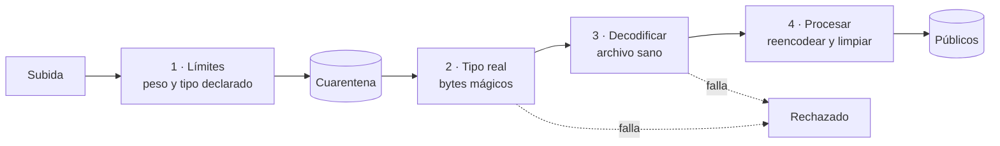

# Subida y validación de archivos

> **Estado:** ✅ vigente (D48, D54) · **Última revisión:** 2026-11-13
> Cómo se reciben, validan, guardan y sirven los archivos que sube el equipo: logos, portadas, el plano del lugar, logos de sponsors, imágenes de premios y la lista de invitados en CSV. Los archivos se guardan **en el VPS**.
> Relacionados: [Stack tecnológico](09-stack-tecnologico.md) · [Amenazas y pruebas](../05-seguridad-legal/01-amenazas-y-pruebas.md) · [Backend](../09-desarrollo/02-backend.md)

## 1. Qué se puede subir

| Propósito | Formatos | Peso máximo | Medidas | Quién |
|---|---|---|---|---|
| Logo del evento, logo de sponsor | PNG, JPEG, WebP | 2 MB | Hasta 2 000 × 2 000 px | Dueño, coorganizador |
| Portada del evento | PNG, JPEG, WebP | 5 MB | Hasta 4 000 × 4 000 px | Dueño, coorganizador |
| Plano del lugar (mapa con puntos numerados) | PNG, JPEG, WebP | 5 MB | Hasta 6 000 × 6 000 px | Dueño, coorganizador |
| Imagen de premio | PNG, JPEG, WebP | 2 MB | Hasta 2 000 × 2 000 px | Dueño, coorganizador |
| Lista de invitados | CSV (UTF-8) | 2 MB | Hasta 5 000 filas | Dueño, coorganizador |

**No se aceptan:** SVG (puede llevar scripts), GIF, HEIC, PDF, archivos comprimidos ni ejecutables. Si el equipo necesita un formato nuevo, se agrega con una nueva entrada en [Decisiones](../decisiones.md).

## 2. El recorrido de un archivo



| Paso | Qué se comprueba | Cómo | Si falla |
|---|---|---|---|
| **1 · Límites** | Peso máximo del propósito, extensión y tipo declarado en la lista permitida, un solo archivo por request | Caddy y Fastify cortan la subida al pasar el peso (no esperan a recibirlo entero). Límite de subidas por usuario | `413` o `400 ARCHIVO_INVALIDO` |
| **Cuarentena** | El archivo se guarda con un nombre aleatorio en una carpeta que **nunca se sirve** | Fuera de la carpeta pública, sin permisos de ejecución | — |
| **2 · Tipo real** | Que el contenido sea de verdad lo que dice la extensión (por ejemplo, que un `.png` empiece con la firma de PNG) | Librería `file-type`, que lee los bytes del inicio | `ARCHIVO_TIPO_NO_PERMITIDO` |
| **3 · Archivo sano** | Que la imagen se pueda abrir completa y no esté corrupta ni truncada. Que no sea una "bomba" (una imagen chica que al abrirla ocupa gigas) | `sharp` la decodifica entera, con límite de píxeles y de medidas. El CSV se lee como UTF-8 y se validan sus columnas | `ARCHIVO_CORRUPTO` o `ARCHIVO_MUY_GRANDE` |
| **4 · Procesar** | Neutralizar cualquier contenido escondido | Las imágenes se **vuelven a codificar** a WebP: se descartan los metadatos (EXIF, ubicación GPS de la foto) y cualquier contenido escondido dentro del archivo. Se generan los tamaños que usan las apps | — |

**Por qué reencodear:** un archivo puede ser al mismo tiempo una imagen válida y otra cosa (un *políglota*), o llevar un programa escondido. Pasitos lee **solo los píxeles** y crea un archivo nuevo; el original se descarta y **nunca llega a nadie**. Una imagen generada así es solo una grilla de colores: no puede llevar un virus.

**Sin antivirus en el piloto (D54).** Un antivirus como ClamAV detecta virus conocidos por su firma. Sirve sobre todo cuando se guardan o reparten los archivos originales, o cuando se aceptan documentos (PDF, Word, ZIP). Pasitos no hace ninguna de las dos cosas: solo acepta imágenes, que reencodea, y CSV, que lee como texto y borra. Por eso los cuatro pasos de arriba alcanzan, y se ahorra el 1,5 GB de memoria que ocupa ClamAV. **Si algún día se aceptan PDF, documentos o archivos comprimidos, se suma un antivirus** con una nueva decisión.

**Qué no se usa:** servicios externos de análisis como VirusTotal. Lo que se sube ahí lo pueden ver terceros.

**Lista de invitados (CSV):** no se guarda como archivo público. Se valida (UTF-8, columnas esperadas, correos con formato válido, duplicados), se importa a la tabla `asistentes` y el archivo se borra. Al **exportar** listas, las celdas que empiezan con `=`, `+`, `-` o `@` se escapan para que Excel no las ejecute como fórmulas.

## 3. Dónde se guardan

En un volumen del VPS:

```text
/srv/pasitos/archivos/
├─ cuarentena/      # Recién subidos. No se sirven. Se borran a las 24 h si no se aprobaron
└─ publicos/
   └─ <organizacion>/<evento>/<id>/
      ├─ original.webp
      ├─ 1200.webp
      └─ 400.webp
```

- **Nombres aleatorios** (el `id` del archivo). El nombre original solo se guarda en la base, limpio, como dato.
- **Caddy sirve** `/archivos/publicos/...` como archivos estáticos con `Content-Type` fijo por extensión, `X-Content-Type-Options: nosniff` y caché larga. Cloudflare los cachea.
- Los archivos de un evento **Privado** se sirven a través del API, que comprueba la sesión, y no como estáticos.
- **Copias de seguridad** (D56): las imágenes se copian cifradas a Google Drive junto con la base.

## 4. Tabla `archivos`

| Columna | Nota |
|---|---|
| `organizacion_id`, `evento_id` | Aislamiento por organización (D47) |
| `proposito` | `logo_evento` · `portada` · `plano` · `logo_sponsor` · `imagen_premio` · `importacion_csv` |
| `nombre_original` | Limpio, solo para mostrar |
| `mime`, `tamano_bytes`, `ancho`, `alto`, `sha256` | Del archivo procesado. El `sha256` permite detectar el mismo archivo subido dos veces |
| `estado` | `cuarentena` · `aprobado` · `rechazado` |
| `motivo_rechazo` | El código de error |
| `variantes` | Tamaños generados y sus rutas |
| `subido_por`, `created_at`, `reemplazado_at` | |

Las tablas que usan imágenes guardan el `archivo_id` (`eventos.logo_archivo_id`, `sponsors.logo_archivo_id`, …).

## 5. Ubicación del evento: Google Maps

El **plano del lugar** es una imagen que sube el organizador (sección 1). La **ubicación del evento** usa Google Maps:

| Dónde | Cómo | Por qué |
|---|---|---|
| Panel del organizador | Buscador de lugares (*Places Autocomplete*) para elegir la dirección. Se guardan `place_id`, latitud y longitud | Evita direcciones mal escritas |
| Sitio público y app del asistente | Una **imagen estática del mapa**, que el servidor pide una sola vez a Google (*Static Maps*) y guarda como un archivo más | No carga el JavaScript de Google en `/app` (cuida el peso) y Google no recibe la IP de cada asistente |
| Botón *Cómo llegar* | Abre Google Maps con la ubicación (`https://www.google.com/maps/search/?api=1&query=…`) | No necesita la llave; abre la app de mapas del celular |

**La llave de Google:**
- **Una llave por uso:** la del panel, restringida por dominio (*HTTP referrer*) y solo a *Places*; la del servidor, restringida por IP del VPS y solo a *Static Maps*.
- Con un tope de uso diario en la consola de Google, para que un abuso no genere costos.
- Se guarda como secreto (sops + age), nunca en el repositorio.

## 6. Errores

Se suman al [catálogo de códigos](../09-desarrollo/04-respuestas-y-errores.md#43-catálogo-de-códigos):

| Código | Estado | Texto para la persona |
|---|---|---|
| `ARCHIVO_MUY_GRANDE` | 413 | El archivo supera el tamaño máximo (por ejemplo, 2 MB). |
| `ARCHIVO_TIPO_NO_PERMITIDO` | 422 | Este tipo de archivo no está permitido. Usa PNG, JPEG o WebP. |
| `ARCHIVO_CORRUPTO` | 422 | No pudimos abrir el archivo. Puede estar dañado. |
| `ARCHIVO_INVALIDO` | 400 | El archivo no cumple los requisitos. |

## 7. Pruebas

- Un archivo de cada tipo permitido pasa; uno de cada tipo prohibido se rechaza.
- Un `.png` que en realidad es otra cosa, una imagen truncada y una "bomba" de descompresión se rechazan.
- Un archivo con un programa pegado al final de una imagen válida (políglota): la imagen servida es nueva y no contiene ese programa.
- Un ejecutable renombrado a `.jpg` se rechaza con `ARCHIVO_TIPO_NO_PERMITIDO`.
- La imagen servida no tiene metadatos EXIF.
- Nada de la carpeta de cuarentena se puede descargar por HTTP.
- Un CSV con `=HYPERLINK(...)` en un nombre se exporta escapado.
