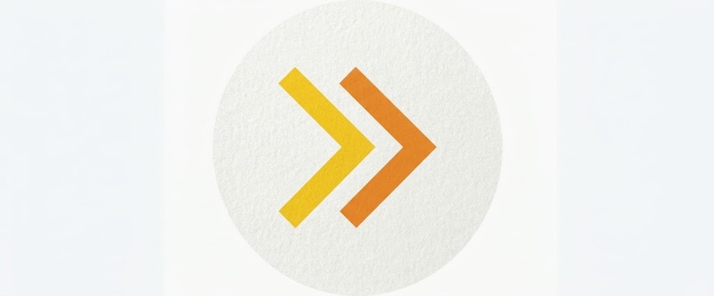

# Marca

> **Estado:** vigente · **Última revisión:** 2026-11-03

## 1. Nombre

**Pasitos**: siempre con mayúscula inicial y el resto en minúsculas. Nunca "PASITOS" en textos corridos ni "pasitos" como nombre propio.

**Qué cuenta el nombre:** cada participación es un paso pequeño (llegar temprano, ir a una charla, quedarse al cierre) y cada paso suma. Las dos flechas del logo avanzan juntas: el asistente avanza en el evento y el organizador avanza con datos que puede demostrar.

## 2. Slogan y frase de apoyo

| | Texto | Uso |
|---|---|---|
| **Slogan** | **Cada paso cuenta.** | Bienvenida de la app, pie del reporte público, portada de presentaciones |
| **Frase de apoyo** | **Puntos por quedarse, reportes que se pueden comprobar.** | Debajo del slogan cuando hay espacio para explicar qué es Pasitos (portada del repositorio, presentaciones, web) |

**Sello en eventos y reportes:** *"Hecho con Pasitos"*.

## 3. Logo

- **Símbolo:** dos flechas (chevrons) que apuntan a la derecha: la primera amarilla y la segunda naranja, dentro de un círculo claro.
- **Significado:** avanzar paso a paso; los dos tonos remiten también a los dos lados del producto (quien participa y quien financia).
- **Archivo actual:** [`assets/brand/pasitos-logo.png`](../../assets/brand/pasitos-logo.png) (1024 × 425 px, fondo de papel con textura, sin transparencia). Sirve como referencia, **no como archivo final**.

### Archivos que faltan 🔍

Pedir a quien diseñó el logo (o redibujarlo, porque es geométrico):

| Archivo | Para qué |
|---|---|
| `pasitos-simbolo.svg` | Solo las dos flechas, vectorial y con fondo transparente |
| `pasitos-logo-horizontal.svg` | Flechas + palabra "Pasitos" al lado |
| `pasitos-simbolo-blanco.svg` / `-negro.svg` | Versiones de un solo color para fondos oscuros, claros o impresión |
| `favicon.svg` + PNG de 32, 192 y 512 px | Pestaña del navegador e ícono de la web app |
| Códigos HEX exactos del amarillo y el naranja | Hoy solo hay valores aproximados, medidos sobre la foto: amarillo ≈ `#ECC223`, naranja ≈ `#E3832B` |

### Reglas de uso

- Dejar alrededor del símbolo un espacio libre de al menos la mitad del ancho de una flecha.
- No deformar, rotar, cambiar el orden de los colores ni agregar sombras.
- Sobre fondos oscuros, usar las flechas sin el círculo claro o la versión blanca.
- Tamaño mínimo del símbolo: 24 px en pantalla.

## 4. Colores de marca

Los colores de la interfaz están definidos en el [Design system](02-design-system.md). Resumen:

| Rol | Tema oscuro | Tema claro |
|---|---|---|
| Marca / puntos | Oro solar `#F59E0B` | Ámbar `#D97706` / ocre `#B45309` |
| Acción / acento | Ámbar cinético `#EA580C` | `#EA580C` |
| Degradado de marca | `#F59E0B → #EA580C` (135°) | Igual |
| Saldo en dólares (solo Feria) | `#3B82F6` / `#2775CA` | `#2563EB` / `#1D4ED8` |

> Cuando llegue el archivo final del logo, hay que confirmar si sus colores exactos coinciden con `#F59E0B` y `#EA580C` o si se ajustan los tokens.

## 5. Tipografía

- **Títulos y saldos:** Plus Jakarta Sans.
- **Interfaz y textos:** Inter.

## 6. Tono de voz

- **Cercano y claro.** Se habla de "puntos", "retos" y "canjear", nunca de "tokens", "mint" o "wallet" en la vista del asistente.
- **Honesto.** Si algo es una demo o está en testnet, se dice.
- **Concreto.** Números y pruebas antes que adjetivos: *"142 asistentes vieron la charla"*, no *"gran participación"*.
- **En español**, con "tú" en la app del asistente.
