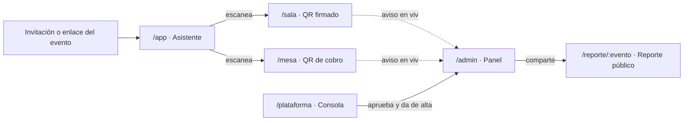

# UX y pantallas

> **Estado:** vigente · **Última revisión:** 2026-11-06
> ⚠️ **Los flujos de la v1 mandan.** Qué hace cada perfil, con qué reglas y qué mensajes ve está en [Flujos de la v1](../01-producto/07-flujos-v1.md). Este documento se ajustó a D22 y D24. Los mockups de los niveles 1 y 2 todavía muestran el modelo anterior (*"Verificando en Stellar…"*, la acción de demo *"Enviar a wallet externa"*) y se actualizarán después de cerrar los flujos.
> Relacionados: [Inventario de vistas](05-inventario-de-vistas.md) · [Design system](02-design-system.md) · [Brief de mockups](04-brief-mockups-ia.md) (textos y datos exactos de cada pantalla) · [Arquitectura](../04-tecnico/01-arquitectura.md)

## 1. Alcance: qué construir y qué no

**El mayor peligro es dispersarse construyendo un SaaS completo de gestión de eventos** (explorar eventos, públicos y privados, venta de entradas…). Pasitos no compite con Eventbrite: su núcleo son los retos, los puntos y el reporte verificable.

| Funcionalidad | Estado | Cómo |
|---|---|---|
| **Gestión de eventos** | ✅ v1 | Consola de plataforma, organizaciones y varios eventos. **Sin** catálogo público de eventos ni venta de entradas: el asistente llega por su invitación o el enlace de un evento |
| **Retos y puntos** | ✅ Núcleo | QR firmado por la pantalla (por tiempo, de un solo uso o bajo demanda) o encuesta. El servidor valida al instante y el libro se sella en Stellar cada 5 min (D22) |
| **Mesa de canje** | ✅ Núcleo | Catálogo de productos con cobro por QR, como un pago con QR bancario |
| **Reporte público verificable** | ✅ Núcleo | `/reporte/:evento` con la página *Verificar este reporte* |
| **Panel del organizador** | ✅ Núcleo | Asistencia y participaciones en vivo (menos de 2 s), equipo, invitados, check-in y bitácora |
| **Circuito cerrado** | ✅ Por diseño | Los puntos no son un token: solo existen en el libro del evento. Ya no hay modal de demo |
| **Estadísticas avanzadas** | ⚠️ Pantalla bloqueada | Botón "Desbloquear estadísticas" |
| **Transferencias entre asistentes** | ❌ No existen | Ni botón ni endpoint (D3) |
| **Saldo en dólares** | ⚠️ Solo variante Feria | Desactivado por defecto (sección 2.5) |

## 2. Usuarios y vistas

Una web app con **rutas por perfil**, cada una compilada por separado para que pese poco ([Rendimiento](../04-tecnico/08-rendimiento.md)).

### 2.1 Asistente (`/app`) · móvil

**Header:** tarjeta de saldo con los puntos del evento (ej. `80 PTS`), el chip *"Vence al cierre"* y el chip *"Puntos válidos solo dentro de Foro Tech 2026"*.

**Acción principal:** botón fijo de ancho completo **[Escanear código QR]**, que abre la cámara (lector nativo del navegador o una librería que se carga solo en ese momento). Un solo lector sirve para los QR de sala o stand (claim) y de la mesa de canje (cobro): la app distingue por el tipo de payload.

**Pestaña Retos:** cada tarjeta muestra el sponsor u organizador, la recompensa, cómo se verifica (QR, automático o encuesta) y el estado (*Pendiente*, *Completado ✓*, *Disponible desde las HH:MM* o *Agotado*).

**Pestaña Canjear:** catálogo de la mesa (café 20 pts, agua 10, merienda 25…). Si no alcanza el saldo, el botón queda deshabilitado con el texto *"Te faltan 30 pts"*.

**Pestaña Historial:** movimientos (retos, canjes y ajustes) con su estado: *Confirmado* al instante y *Registrado en Stellar ✓* cuando se sella su lote.

**Información del evento:** agenda, mapa, stands y sponsors, preguntas frecuentes ([Flujos §5.2](../01-producto/07-flujos-v1.md#52-qué-ve-en-la-app)).

**Mi cuenta:** tamaño de texto, tema, mi dispositivo, salir. Sin *Borrar mis datos* (D35). **Nunca hay opción para enviar puntos a otra persona.** La acción de demo *"Enviar a wallet externa"* del MVP ya no existe (D22).

### 2.2 Sala o stand (`/sala`) · tablet o monitor

- **Cabecera:** logo del sponsor ficticio y nombre del reto.
- **Centro:** **QR rotativo grande** con un anillo de cuenta regresiva de 30 s.
- **Pie:** contador en vivo *"47 asistentes verificados hoy"* y *"Hecho con Pasitos"*.
- Se conecta con un QR o enlace de un solo uso (D18). La tablet **firma ella misma el QR**, sin pedirlo al servidor.
- Modos de QR, controles con PIN (*Generar otro*, *Pausar*, *Mostrar QR*) e historial: [Flujos §6](../01-producto/07-flujos-v1.md#6-pantalla-de-sala-o-stand).
- **Margen de gracia:** cuando el QR cambia solo, el anterior sigue valiendo 5 s. Cuando el operador pausa o genera otro, no hay margen.

### 2.3 Mesa de canje (`/mesa`) · tablet o móvil

- **Conexión del dispositivo (D18):** QR de un solo uso (vence en 2 min) que muestra el organizador, o enlace de un solo uso (vence en 24 h). Al usarse, el dispositivo queda registrado y el enlace deja de servir. El organizador puede desconectar cada dispositivo. No hay código de 6 dígitos.
- **Conexión a internet obligatoria (D21):** la mesa siempre trabaja en línea, con una red dedicada o datos móviles propios.
- **Teclado rápido** de productos con su precio en puntos.
- **Generador de cobro:** QR de un solo uso con uno o varios productos. Vence en 2 min y reserva el stock.
- **Feed en vivo:** aviso verde con el **código de comprobante** cuando el asistente confirma. Se entrega el producto solo después de verlo en la pantalla de la mesa.
- **Cuadre:** resumen por producto para contarlo contra lo físico ([Flujos §7](../01-producto/07-flujos-v1.md#7-mesa-de-canje)).

### 2.4 Panel del organizador (`/admin`) · desktop

- **Resumen:** asistentes verificados, participaciones, curva de asistencia por franja horaria, puntos emitidos, canjeados y vencidos.
- **Retos:** participaciones por reto y por sponsor, con su presupuesto (`max_total`) consumido.
- **Reporte:** vista previa del reporte público, botón para copiar el link y descargar el PDF.
- **Estadísticas avanzadas:** pestaña bloqueada con el botón *"Desbloquear estadísticas"*.
- **Cerrar evento:** vencen los puntos sin usar, se sella el último lote y se registra el cierre en Stellar. Pide escribir `CERRAR` porque es irreversible.
- **Equipo, invitados, check-in, ajustes y bitácora:** [Flujos §4](../01-producto/07-flujos-v1.md#4-organizador).

### 2.5 Reporte público (`/reporte/:evento`) · web responsiva

Contenido del reporte simple *(interno)*: resumen, participación, por sponsor, retención básica, puntos y verificación (página *Verificar este reporte*, que compara los lotes con las huellas en Stellar). Pie con *"Cada paso cuenta · Hecho con Pasitos"*. Tema claro.

### 2.6 Variante Feria (saldo en dólares activado)

Solo cuando el organizador lo activa:
- La tarjeta de saldo se vuelve **dual**: puntos en ámbar y dólares en azul, claramente separados.
- La mesa de canje elige **Puntos** o **USD** antes de generar el cobro. Un cobro = una moneda (D6).
- Los pagos en USD dan 5 % de cashback en puntos.
- Botón *"Reembolsar"* para devolver el saldo sobrante.

## 3. Estados, tiempos y mensajes

Con el libro anclado (D22), **el servidor confirma al instante**. Lo que ve el usuario ya es definitivo; el sello en Stellar llega unos minutos después y se muestra como un estado extra, no como una espera.

| Momento | Qué ve el usuario |
|---|---|
| Escaneo leído | Vibración + indicador breve (menos de 1 s) |
| Confirmado | Hoja de confirmación: *"¡Reto completado!"*, **+20 PTS** y botón **Seguir**. No se cierra sola |
| Tarda más de 3 s | *"Seguimos intentando…"* (reintento automático) |
| Falla de red | *"No pudimos conectar. Intenta de nuevo"* + **Reintentar**, que reenvía la misma acción sin duplicarla |
| Lote sellado | En el historial: *"Registrado en Stellar ✓"* |

Los mensajes de cada rechazo (ya completado, QR cambiado o ya usado, fuera de horario, agotado, sin check-in, evento pausado o cerrado, saldo insuficiente, cobro ya pagado) están en [Flujos §5.3](../01-producto/07-flujos-v1.md#53-ganar-puntos-con-un-qr) y [§5.5](../01-producto/07-flujos-v1.md#55-canjear-como-pagar-con-qr).

## 4. Requisitos técnicos que afectan al diseño

| Requisito | Por qué importa |
|---|---|
| **HTTPS obligatorio** | El navegador **no abre la cámara** fuera de un contexto seguro. `localhost` funciona en la computadora, pero desde el celular por IP local (`http://192.168.x.x`) **no**. Para probar en celulares: desplegar en Vercel o Netlify, o usar un túnel HTTPS (`cloudflared`, `ngrok`) |
| Permiso de cámara | Si el usuario lo niega, mostrar instrucciones y un campo para pegar el código del QR a mano |
| iOS Safari | Probar el lector en iPhone desde el principio: es donde más falla `getUserMedia` |
| QR legible | Payload corto (ID del reto + expiración + firma). Probar el escaneo a 1–2 metros desde un celular de gama media |
| Reset de demo | Ver [Setup en testnet §3](../04-tecnico/06-setup-testnet.md#3-reset-de-demo) |

## 5. Ingreso sin fricción

- Sin nada que instalar. La cuenta usa correo y contraseña (D26).
- **Con invitación:** el enlace personal entra directo la primera vez y la persona define su contraseña. Después, en otro dispositivo, entra con correo y contraseña.
- **Sin invitación:** el QR o el enlace del evento, crear la cuenta con correo y contraseña, y verificar el correo con un código de 6 dígitos (o el botón del correo).
- **En la puerta:** el registrador puede mostrar un QR de un solo uso para entrar sin código, pensado para personas mayores.
- Detalle y casos borde: [Flujos §2 y §4.5](../01-producto/07-flujos-v1.md#2-identidad-y-acceso).

## 6. Detalles que suman

### 6.1 QR rotativo
El anillo de cuenta regresiva convence de inmediato de que una foto enviada por WhatsApp no sirve. Conviene decirlo en voz alta en las demos.

### 6.2 "Verificar este reporte"
Reemplaza al modal de rechazo del circuito cerrado del MVP. Es la mejor demostración para un sponsor: un botón que recalcula las huellas, las compara con las de Stellar y responde en lenguaje simple: *"✓ Los 412 movimientos coinciden con los 38 sellos registrados en Stellar. Ningún reto superó su tope."*

### 6.3 Animación mínima
- Solo transiciones funcionales cortas (abrir una hoja, cambiar de pestaña), de 200 ms o menos.
- El saldo se actualiza sin efectos. Las confirmaciones se quedan hasta que la persona toca **Seguir**.
- Reglas completas en el [Design system §3](02-design-system.md#3-reglas-de-ux-y-accesibilidad).

## 7. Checklist de diseño

- [ ] Todas las vistas funcionan en Android e iOS.
- [ ] Los QR se leen a 1–2 m, sobre fondo blanco.
- [ ] Todos los errores de la sección 3 tienen su mensaje.
- [ ] *Verificar este reporte* funciona con los lotes reales del evento.
- [ ] `/admin`, `/stand` y el reporte se ven bien en el proyector (tema claro).
- [ ] Solo sponsors ficticios (Nimbora Cloud, Quillu Pay, Kodara Academy); ninguna marca real.
- [ ] Ningún cobro permite mezclar puntos y dólares.
- [ ] No existe forma de enviar puntos a otro asistente.
- [ ] El saldo en dólares no aparece si la variante Feria está desactivada.
