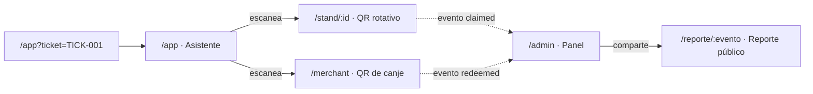

# UX y pantallas

> **Estado:** vigente · **Última revisión:** 2026-11-03
> Relacionados: [Inventario de vistas](05-inventario-de-vistas.md) · [Design system](02-design-system.md) · [Brief de mockups](04-brief-mockups-ia.md) (textos y datos exactos de cada pantalla) · [Arquitectura](../04-tecnico/01-arquitectura.md)

## 1. Alcance: qué construir y qué no

**El mayor peligro es dispersarse construyendo un SaaS completo de gestión de eventos** (explorar eventos, públicos y privados, venta de entradas…). Pasitos no compite con Eventbrite: su núcleo son los retos, los puntos y el reporte verificable.

| Funcionalidad | Estado | Cómo |
|---|---|---|
| **Catálogo de eventos** | ⚠️ Un solo evento activo | El asistente entra directo al evento activo (*Foro Tech 2026*). Sin CRUD de eventos |
| **Retos y puntos** | ✅ Núcleo | QR rotativo o verificación automática + claim desde el celular + validación on-chain |
| **Mesa de canje** | ✅ Núcleo | Catálogo de productos con cobro en puntos (`redeem`) |
| **Reporte público verificable** | ✅ Núcleo | `/reporte/:evento` con enlaces a Stellar Expert |
| **Panel del organizador** | ✅ Núcleo | Asistencia y participaciones casi en tiempo real (menos de 10 s) |
| **Circuito cerrado on-chain** | ✅ Demostrable | Modal de demo que intenta enviar puntos a una wallet externa y falla (sección 6.2) |
| **Estadísticas avanzadas** | ⚠️ Pantalla bloqueada | Botón "Desbloquear por $25" |
| **Transferencias entre asistentes** | ❌ No existen | Ni botón ni endpoint (D3) |
| **Saldo en dólares** | ⚠️ Solo variante Feria | Desactivado por defecto (sección 2.5) |

## 2. Usuarios y vistas

Una sola app web responsiva con **rutas por perfil**, no aplicaciones separadas.

### 2.1 Asistente (`/app`) · móvil

**Header:** tarjeta de saldo con los puntos del evento (ej. `80 PTS`), el chip *"Vence al cierre"* y el chip *"Puntos válidos solo dentro de Foro Tech 2026"*.

**Acción principal:** botón fijo de ancho completo **[Escanear código QR]**, encima de las 3 pestañas, que abre la cámara con `html5-qrcode`. Un solo lector sirve para los QR de sala o stand (claim) y de la mesa de canje (cobro): la app distingue por el tipo de payload.

**Pestaña Retos:** cada tarjeta muestra el sponsor u organizador, la recompensa, cómo se verifica (QR, automático o encuesta) y el estado (*Pendiente*, *Completado ✓* o *Disponible desde las HH:MM*), leído de `claims_of`.

**Pestaña Canjear:** catálogo de la mesa (café 20 pts, agua 10, merienda 25…). Si no alcanza el saldo, el botón queda deshabilitado con el texto *"Te faltan 30 pts"*.

**Pestaña Historial:** movimientos (retos y canjes) con enlace a la transacción en Stellar Expert.

**Modal "Mi cuenta" (solo demo):** opción *"Enviar a wallet externa"* para provocar el rechazo del circuito cerrado. El destino es **fijo** (la wallet externa de demo). **En producción esta opción no existe.** Nunca hay opción para enviar puntos a otro asistente.

### 2.2 Sala o stand (`/stand/:id`) · tablet o monitor

- **Cabecera:** logo del sponsor ficticio y nombre del reto.
- **Centro:** **QR rotativo grande** con un anillo de cuenta regresiva de 30 s.
- **Pie:** contador en vivo *"47 asistentes verificados hoy"* y *"Hecho con Pasitos"*.
- No hace falta login: con el ID en la URL, la pantalla pide al backend el token HMAC vigente y lo rota.
- **Detalle técnico:** aceptar también el QR del ciclo anterior durante unos segundos de gracia (ej. 5 s). Si no, quien escanea justo al final del ciclo recibe "QR vencido".

### 2.3 Mesa de canje (`/merchant`) · tablet o móvil

- **Teclado rápido** de productos con su precio en puntos.
- **Generador de cobro:** QR con `{merchant, item_id, amount, currency: "PTS"}`.
- **Feed en vivo:** aviso verde cuando aparece el evento `redeemed` de **ese** cobro. Solo después de verlo se entrega el producto.

### 2.4 Panel del organizador (`/admin`) · desktop

- **Resumen:** asistentes verificados, participaciones, curva de asistencia por franja horaria, puntos emitidos, canjeados y vencidos.
- **Retos:** participaciones por reto y por sponsor, con su presupuesto (`max_total`) consumido.
- **Reporte:** vista previa del reporte público, botón para copiar el link y descargar el PDF.
- **Estadísticas avanzadas:** pestaña bloqueada con el botón *"Desbloquear por $25"*.
- **Cerrar evento:** ejecuta `close_event` y luego `expire` (clawback de los puntos sin usar). Pide confirmación porque es irreversible.
- **Lista auditable:** cada participación enlaza a su transacción `claim` en Stellar Expert.

### 2.5 Reporte público (`/reporte/:evento`) · web responsiva

Contenido del [reporte simple](../02-negocio/04-plan-comunidad.md#4-reporte-simple-verificable-gratis): resumen, participación, por sponsor, retención básica, puntos y verificación (dirección del contrato + Stellar Expert). Pie con *"Cada paso cuenta · Hecho con Pasitos"*. Tema claro.

### 2.6 Variante Feria (saldo en dólares activado)

Solo cuando el organizador lo activa:
- La tarjeta de saldo se vuelve **dual**: puntos en ámbar y dólares en azul, claramente separados.
- La mesa de canje elige **Puntos** o **USD** antes de generar el cobro. Un cobro = una moneda (D6).
- Los pagos en USD dan 5 % de cashback en puntos.
- Botón *"Reembolsar"* para devolver el saldo sobrante.

## 3. Estados, tiempos y mensajes

Una transacción en Stellar tarda unos 5 segundos en confirmarse. **No mostrar el éxito antes de la confirmación.** Si la UI dice "verificado on-chain", tiene que serlo.

| Momento | Qué ve el usuario |
|---|---|
| Escaneo leído | Vibración + *"Verificando en Stellar…"* con spinner (0–6 s) |
| Confirmado | Hoja de confirmación: *"¡Reto completado!"*, **+20 PTS**, *"Verificado en Stellar"* y botón **Seguir**. No se cierra sola |
| Tarda más de 10 s | *"La red está tardando, no cierres la app"* |
| Falla de red o del backend | *"No pudimos conectar. Intenta de nuevo"* + botón para reintentar |

### Errores del contrato → mensaje para el usuario

| Error ([contrato](../04-tecnico/02-contrato-challenges.md#4-errores)) | Mensaje |
|---|---|
| `UserLimitReached` | *"Ya completaste este reto 👌"* |
| `BudgetExhausted` | *"Este reto ya agotó sus premios"* |
| `OutOfWindow` | *"Este reto se habilita a las HH:MM"* |
| `ChallengeInactive` | *"Este reto no está activo"* |
| `EventClosed` | *"El evento ya cerró. Tus puntos vencieron."* (en Feria: *"…tu saldo en dólares sigue disponible para reembolso"*) |
| `Paused` | *"Pausamos el sistema un momento. Tu saldo está seguro"* |
| `NotMerchant` | *"Esta mesa no es parte del evento"* |
| QR vencido (backend) | *"El código cambió, escanéalo de nuevo"* |
| Saldo insuficiente | *"Te faltan X pts"* |

## 4. Requisitos técnicos que afectan al diseño

| Requisito | Por qué importa |
|---|---|
| **HTTPS obligatorio** | El navegador **no abre la cámara** fuera de un contexto seguro. `localhost` funciona en la computadora, pero desde el celular por IP local (`http://192.168.x.x`) **no**. Para probar en celulares: desplegar en Vercel o Netlify, o usar un túnel HTTPS (`cloudflared`, `ngrok`) |
| Permiso de cámara | Si el usuario lo niega, mostrar instrucciones y un campo para pegar el código del QR a mano |
| iOS Safari | Probar el lector en iPhone desde el principio: es donde más falla `getUserMedia` |
| QR legible | Payload corto (ID del reto + expiración + firma). Probar el escaneo a 1–2 metros desde un celular de gama media |
| Reset de demo | Ver [Setup en testnet §3](../04-tecnico/06-setup-testnet.md#3-reset-de-demo) |

## 5. Ingreso sin fricción

- Sin formulario de registro, contraseña ni email para el asistente.
- Entra con el link directo de su entrada (`/app?ticket=TICK-001`). La app inicia sesión y crea su wallet en segundo plano.
- El código de entrada se **vincula una sola vez** a una wallet (mitiga la amenaza T1). Después de la primera vez, la sesión se guarda y el parámetro se quita de la URL. En el MVP, quien tenga el link puede entrar como ese asistente; en producción no se acepta.

## 6. Detalles que suman

### 6.1 QR rotativo
El anillo de cuenta regresiva convence de inmediato de que una foto enviada por WhatsApp no sirve. Conviene decirlo en voz alta en las demos.

### 6.2 El rechazo del circuito cerrado
Para que el rechazo quede registrado en la red, se usa una **operación clásica `payment`** hacia una wallet con trustline **no autorizada**, enviada sin chequeo previo (detalle en [contrato §7.4](../04-tecnico/02-contrato-challenges.md#74-intento-de-sacar-puntos-del-evento)). Modal:

> 🛑 **Transacción rechazada por la red Stellar**
> *Política de circuito cerrado: estos puntos solo pueden estar en cuentas autorizadas por el evento (asistentes y mesas de canje). La cuenta de destino no está autorizada.*
> [Ver en Stellar Expert ↗]

### 6.3 Animación mínima
- Solo transiciones funcionales cortas (abrir una hoja, cambiar de pestaña), de 200 ms o menos.
- El saldo se actualiza sin efectos. Las confirmaciones se quedan hasta que la persona toca **Seguir**.
- Reglas completas en el [Design system §3](02-design-system.md#3-reglas-de-ux-y-accesibilidad).

## 7. Checklist de diseño

- [ ] Todas las vistas funcionan en Android e iOS.
- [ ] Los QR se leen a 1–2 m, sobre fondo blanco.
- [ ] Todos los errores de la sección 3 tienen su mensaje.
- [ ] El modal del circuito cerrado enlaza a una transacción fallida real en Stellar Expert.
- [ ] `/admin`, `/stand` y el reporte se ven bien en el proyector (tema claro).
- [ ] Solo sponsors ficticios (Nimbora Cloud, Quillu Pay, Kodara Academy); ninguna marca real.
- [ ] Ningún cobro permite mezclar puntos y dólares.
- [ ] No existe forma de enviar puntos a otro asistente.
- [ ] El saldo en dólares no aparece si la variante Feria está desactivada.
