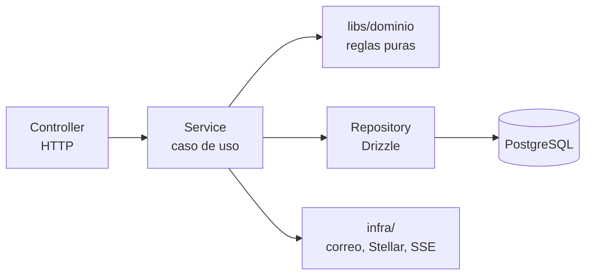

# Reglas del backend (NestJS)

> **Estado:** 📝 propuesta para revisar con el equipo · **Última revisión:** 2026-11-13
> Estructura, capas, patrones y reglas del API (`apps/api`) y del trabajador (`apps/trabajador`). Antes de leer esto: [Reglas generales](01-reglas-generales.md). El formato de las respuestas y los errores está en [Respuestas y errores del API](04-respuestas-y-errores.md).
> Relacionados: [Stack §4](../04-tecnico/09-stack-tecnologico.md#4-backend-nestjs) · [Libro y anclaje](../04-tecnico/07-libro-y-anclaje.md) · [Rendimiento](../04-tecnico/08-rendimiento.md)

## 1. Estructura

### 1.1 API (`apps/api`)

```text
apps/api/src/
├─ main.ts                  # Arranque: Fastify, filtros globales, cierre ordenado
├─ app.module.ts
├─ config/                  # Variables de entorno validadas con Zod al arrancar
├─ common/                  # Lo transversal, sin lógica de negocio
│  ├─ errors/               # AppError y ProblemDetailsFilter
│  ├─ guards/               # SessionGuard, DispositivoGuard, RolesGuard
│  ├─ decorators/           # @Roles(), @CurrentUsuario(), @CurrentAsistente()
│  ├─ pipes/                # ZodValidationPipe
│  └─ interceptors/         # traceId, logging, idempotencia
├─ infra/                   # Adaptadores a servicios externos
│  ├─ db/                   # Cliente de Drizzle y transacciones
│  ├─ stellar/              # Cliente RPC (solo lectura en el API)
│  ├─ correo/               # Proveedor de correo
│  └─ eventos-tiempo-real/  # SSE + LISTEN/NOTIFY
└─ modules/                 # Un módulo por concepto del dominio
   ├─ auth/
   ├─ eventos/
   ├─ invitaciones/
   ├─ dispositivos/
   ├─ check-ins/
   ├─ retos/
   ├─ movimientos/          # Libro de movimientos
   ├─ canjes/
   ├─ premios/
   ├─ alertas/
   ├─ bitacora/
   ├─ reportes/
   └─ archivos/            # Subida y validación (D48)
```

### 1.2 Dentro de un módulo

```text
modules/canjes/
├─ canjes.module.ts
├─ canjes.controller.ts       # HTTP: rutas, permisos, validación de entrada
├─ canjes.service.ts          # Casos de uso: reglas, transacción, orquestación
├─ canjes.repository.ts       # Consultas con Drizzle, nada más
├─ canjes.errors.ts           # Errores del módulo, tomados del catálogo
├─ canjes.service.spec.ts     # Tests unitarios
└─ canjes.int.spec.ts         # Tests de integración con PostgreSQL
```

- Los **esquemas Zod** de entrada y salida no van en el módulo: viven en `libs/dominio/canjes/` porque los usan también las apps.
- El **esquema de tablas** vive en `libs/db`.

### 1.3 Trabajador (`apps/trabajador`)

Aplicación NestJS sin HTTP (*standalone*) que procesa las colas de pg-boss.

```text
apps/trabajador/src/
├─ main.ts
├─ jobs/
│  ├─ anchor-lote.job.ts        # Sella un lote en Stellar (concurrencia 1, en orden)
│  ├─ send-correo.job.ts
│  ├─ purge-dispositivos.job.ts # Borra datos técnicos a los 30 días (D35)
│  └─ build-reporte.job.ts
└─ ...
```

- **Nombres de trabajos:** `kebab-case`, verbo + sustantivo (`anchor-lote`, `purge-dispositivos`).
- **Todo trabajo es idempotente:** si se ejecuta dos veces, el resultado es el mismo. pg-boss reintenta.
- Reutiliza los servicios y repositorios de `apps/api` a través de `libs/`, no copiando código.

## 2. Capas y quién hace qué



| Capa | Hace | No hace |
|---|---|---|
| **Controller** | Define la ruta, aplica guards y roles, valida la entrada con Zod, llama a **un** método del servicio y devuelve su resultado | Reglas de negocio, consultas, `try/catch` para armar respuestas |
| **Service** | Un método por caso de uso (`confirmCanje`, `completeReto`). Abre la transacción, aplica las reglas, llama a repositorios y adaptadores, lanza `AppError` | Conocer HTTP (`Request`, `HttpException`, códigos de estado) |
| **`libs/dominio`** | Funciones puras: calcular saldos, validar topes, verificar vigencia de un QR | Acceso a base, red o reloj del sistema |
| **Repository** | Consultas y escrituras con Drizzle, siempre filtradas por `evento_id` | Decidir si algo se puede hacer |
| **infra/** | Hablar con el exterior detrás de una interfaz (`CorreoPort`, `StellarPort`) | Reglas de negocio |

**Reglas entre módulos:**
- Un módulo **no usa el repositorio de otro**. Si `canjes` necesita el saldo, llama a `MovimientosService`.
- Sin dependencias circulares. Si dos módulos se necesitan mutuamente, falta un tercer módulo o un evento.

## 3. Patrones que se usan

| Patrón | Dónde | Por qué |
|---|---|---|
| **Módulos por dominio** | `modules/*` | Cada concepto tiene un lugar; el código de canjes no se reparte por todo el proyecto |
| **Caso de uso en el servicio** | `*.service.ts` | Una operación del negocio, una transacción, un método |
| **Repository** | `*.repository.ts` | Aísla las consultas y permite probarlas contra una base real |
| **Puertos y adaptadores** | `infra/` | Cambiar de proveedor de correo o de RPC sin tocar los casos de uso; en tests se reemplazan |
| **Transacción por caso de uso** | `db.transaction()` en el servicio | O se guarda todo o nada |
| **Outbox** | Tabla `outbox` en la misma transacción | El aviso en vivo (SSE) y el trabajo de anclaje nunca se pierden aunque el proceso se caiga |
| **Idempotencia** | Interceptor + `Idempotency-Key` | Un reintento no duplica un canje ni puntos ([Respuestas §6](04-respuestas-y-errores.md#6-operaciones-que-mueven-puntos-idempotencia)) |
| **Strategy** | Tipos de reto (QR de sala, encuesta, cierre) | Sumar un tipo de reto nuevo sin tocar los existentes |
| **Reloj inyectable** | `ClockPort` | Probar vencimientos de QR y cierres sin esperar |

**Patrones que no se usan en el piloto:** CQRS separado, *event sourcing* completo, microservicios, colas externas (Redis, RabbitMQ). El libro de movimientos ya es *append-only*; no hace falta más.

## 4. Reglas del libro de movimientos

Es la parte más delicada del sistema ([Libro y anclaje](../04-tecnico/07-libro-y-anclaje.md)):

1. **Solo se agregan filas.** La tabla `movimientos` no admite `UPDATE` ni `DELETE`: lo impiden un *trigger* y los permisos del usuario de la base.
2. **Las correcciones son movimientos nuevos** de tipo `ajuste`, con motivo y autor, que quedan en la bitácora.
3. **El saldo se calcula, no se guarda a mano.** Si se guarda en caché, se actualiza en la misma transacción que el movimiento.
4. **Sin carreras:** toda operación que cambia puntos bloquea primero la fila del saldo del asistente (`SELECT … FOR UPDATE` sobre `saldos`). Dos canjes simultáneos se ejecutan uno detrás del otro y el saldo nunca queda negativo (`CHECK (puntos >= 0)`).
5. **Topes en la base:** restricciones `UNIQUE` (por ejemplo, en `participaciones`) y verificaciones dentro de la transacción, no solo en el código.
6. **Cada movimiento lleva:** id, evento, asistente, tipo, puntos (entero con signo), referencia (reto, canje, ajuste), firma del dispositivo cuando corresponde, `created_at` y `created_by`.
7. **La asignación a un lote no modifica el movimiento:** se agrega en `movimientos_lote`, que también es de solo agregar.

## 5. Seguridad en el código

- **Aislamiento por organización (D47):** además del filtro en el código, la base aplica RLS. Toda transacción del API empieza fijando la organización (`set_config('app.organizacion_id', …, true)`) con el helper `withOrganizacion()`; sin eso, las consultas no devuelven nada (Modelo de datos *(interno)*).
- **Toda consulta va filtrada por evento.** El `eventoId` sale de la ruta y se verifica que el usuario o el asistente pertenezca a ese evento (guard). Nunca se confía en un `eventoId` que viene en el cuerpo.
- **Guards:** `SessionGuard` para el equipo, `DispositivoGuard` para el asistente (verifica la sesión y la firma P-256), `RolesGuard` con `@Roles('registrador')`.
- **Sin SQL armado a mano** con texto concatenado. Drizzle o `sql` con parámetros.
- **Logs sin datos personales:** pino con `redact` para `email`, `nombre`, `ip`, `password`, `cookie`, `authorization`.
- **Límites de uso** (`@fastify/rate-limit`) en login, vinculación y canje.
- **Secretos** solo por variables de entorno validadas; nunca en el código ni en logs.
- **Archivos subidos:** siempre por el módulo `archivos`, que valida y reencodea ([Subida de archivos](../04-tecnico/10-subida-de-archivos.md)). Ningún otro módulo guarda archivos del usuario.

## 6. Configuración

- Las variables de entorno se validan con un esquema Zod **al arrancar**. Si falta una o es inválida, el proceso no arranca.
- Se accede a la configuración por un servicio tipado (`AppConfig`), nunca con `process.env` suelto.
- Hay un `.env.example` con todas las variables y valores de ejemplo.

## 7. Base de datos

- **Esquema en `libs/db`** con Drizzle. Migraciones generadas con `drizzle-kit generate`, revisadas en el PR y aplicadas en el despliegue.
- **Una migración aplicada no se edita nunca.** Se corrige con una nueva.
- **Cambios que rompen** en dos pasos (*expand/contract*): primero se agrega lo nuevo, después se quita lo viejo.
- **Claves:** UUID v7 como id interno. Los códigos que ven las personas (`A-0231`, `C-4821`) son columnas aparte, únicas por evento.
- **Fechas** en `timestamptz`. **Puntos** en `integer`.
- **Claves foráneas e índices** en toda columna `*_id` y en las columnas por las que se busca.
- **Listas siempre paginadas** (por cursor). Nada de `SELECT` sin límite.
- **Sin N+1:** si un endpoint hace consultas dentro de un bucle, se reescribe.

## 8. Logs y observabilidad

| Nivel | Cuándo |
|---|---|
| `error` | Errores 5xx o inesperados. Va a Sentry con su `traceId` |
| `warn` | Situaciones raras que no rompen: reintentos, alertas de fraude, anclaje demorado |
| `info` | Una línea por request (ruta, estado, duración, `traceId`) y eventos del negocio (`canje.confirmado`) |
| `debug` | Solo en desarrollo |

- Cada request tiene un **`traceId`** que viaja en el header `X-Request-Id`, en los logs y en la respuesta de error.
- Los errores 4xx esperados (saldo insuficiente, QR vencido) **no** van a Sentry: son parte del negocio.

## 9. Rendimiento

- Objetivo: **p95 < 300 ms** en el servidor ([Rendimiento](../04-tecnico/08-rendimiento.md)).
- Ganar puntos y canjear se resuelven **en el mismo request**, sin colas. Lo lento (correos, reportes, anclaje) va al trabajador.
- Ninguna llamada a Stellar dentro de un request del asistente.

## 10. Tests

- **Servicios:** unitarios con los puertos reemplazados (reloj, correo, Stellar).
- **Endpoints que escriben:** integración contra PostgreSQL real (Testcontainers), incluyendo concurrencia: dos canjes a la vez con saldo para uno solo.
- **Trabajos:** se prueba que son idempotentes ejecutándolos dos veces.
- **Errores:** cada código del catálogo que lanza un servicio tiene un test que lo provoca.

## 11. Lo que no se hace

- ❌ Lógica de negocio en controladores o en repositorios.
- ❌ `HttpException` dentro de un servicio (se lanza `AppError`).
- ❌ Devolver entidades de la base directo al cliente: siempre pasan por el esquema de salida.
- ❌ `console.log` (se usa el logger).
- ❌ Leer `process.env` fuera de `config/`.
- ❌ Llamar a servicios externos dentro de una transacción de la base.
